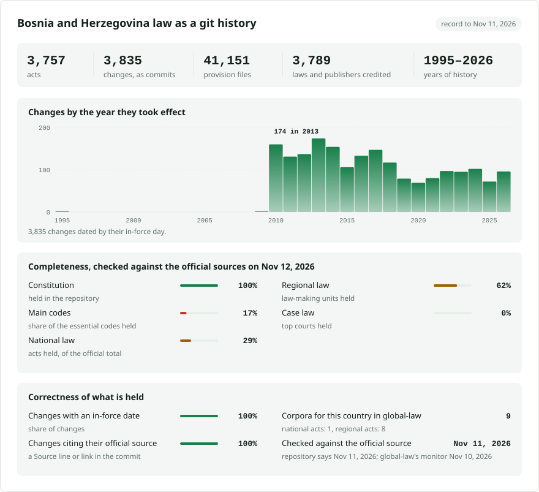

# Bosnia and Herzegovina: law history in git

**English** · **[Ili pročitajte na bosanskom](README.md)**

<picture>
<source media="(prefers-color-scheme: dark)" srcset="data/effort-dark.svg">

</picture>

The law of the state of Bosnia and Herzegovina as a git history: one file per article, one commit per version on the day it took effect, and the act that published each version as the commit's author. `git blame` names the act behind every line; `git log` lists every change to an article; picking a date gives the text in force that day.

Part of [lexifina/global-law](https://github.com/lexifina/global-law), one git history for every country's law: this is Bosnia and Herzegovina's state-level law, which global-law reads at `bosnia-and-herzegovina/national/acts/`. The law of the entities and the Brčko District is in [bosnia-federation-law](https://github.com/lexifina/bosnia-federation-law), [bosnia-republika-srpska-law](https://github.com/lexifina/bosnia-republika-srpska-law), [bosnia-brcko-law](https://github.com/lexifina/bosnia-brcko-law) and the canton repositories.

**What is in it now:** the Constitution, the Criminal Code and 1,875 acts published in Službeni glasnik BiH from 2010 to 2026 (199 laws of the Parliamentary Assembly and 1,676 rulebooks, instructions, rules of procedure and rules of state institutions), 21 of them with a later official consolidated text and 37 ending in their repeal. [`PLAN.md`](PLAN.md) lists every part this repository is meant to hold and how far each one is; [`registry/ACTS.md`](registry/ACTS.md) lists every act from the Gazette, by kind.

Each Gazette act is in `<kind>/<year>/sg<issue>-<id>/`, by the Gazette issue that published it (`zakon/2010/sg012-183639/` is the Zakon Bosne i Hercegovine o izvršenju krivičnih sankcija, pritvora i drugih mjera, the Law on the Execution of Criminal Sanctions, Detention and Other Measures, in its official consolidated text in "Službeni glasnik BiH" 12/2010). The Constitution is in [`constitution/`](constitution/) and the Criminal Code in [`criminal-code/`](criminal-code/). `registry/data/paths.json` maps each act id to its folder.

The Gazette acts are in Bosnian, in Latin script, as Službeni list BiH publishes them (the Gazette also prints them in Croatian and Serbian). The Constitution is in English, its authentic text, and the Criminal Code in an unofficial English consolidation. An English translation of the Gazette acts is not part of this record.

## Questions as git commands

| Question | Command |
| --- | --- |
| Every change to Article 1 of the Law on the Execution of Criminal Sanctions | `git log -p --word-diff -- zakon/2010/sg012-183639/art-001.md` |
| Which act wrote each line of Article 1? | `git blame zakon/2010/sg012-183639/art-001.md` |
| Every version of the law, with the day each took effect | `git log --format="%h %(trailers:key=In-force,valueonly,separator=) %an" -- zakon/2010/sg012-183639` |
| Article 1 as in force on 1 January 2015 | `python tools/on.py 2015-01-01 zakon/2010/sg012-183639 art-001` |

**Outside git**, we also host this record publicly, for free:

- **[Ask Claude about the law of Bosnia and Herzegovina](https://global-law.lexifina.com/v1/try_claude?country=bosnia-and-herzegovina)**: opens Claude with a first question ready.
- **[Ask ChatGPT](https://global-law.lexifina.com/v1/try_chatgpt?country=bosnia-and-herzegovina)**: the same question in ChatGPT.
- **[Call the API in your browser](https://global-law.lexifina.com/v1/search_law?query=godi%C5%A1nji+odmor&jurisdictions=bosnia-and-herzegovina)**: a search of the law of Bosnia and Herzegovina for "godišnji odmor", returned as JSON. See the [documentation here](https://lexifina.com/api/global-law).

Both assistants read the record through the free Global law connector (MCP, `https://global-law.lexifina.com/mcp`); the first time, the chat gives you the link that adds it. Ask in Bosnian, Croatian or Serbian, or in English.

**Host it yourself easily.** All it takes is git and Python, and the tools run on your machine:

```sh
git clone --depth 1 https://github.com/lexifina/global-law && cd global-law
python3 tools/countries.py add bosnia-and-herzegovina/national/acts
python3 tools/law.py show 2026-01-01 bosnia-and-herzegovina/national/acts/zakon/2010/sg012-183639/art-001.md
```

Opened in Claude Code, Cursor, VS Code or Codex, the clone also starts a local MCP server with the same tools ([MCP.md](https://github.com/lexifina/global-law/blob/main/MCP.md)).

## Dates

Each commit is dated at noon, Europe/Sarajevo, on the day the version took effect, and carries it in its `In-force:` trailer:

- for a Gazette act, the day its own final article names, almost always the eighth day after its publication;
- for an official consolidated text ("prečišćeni tekst"), the day of its Gazette issue: it is a later version of the act it consolidates;
- for a repeal, a last, empty version on the day the repealing act takes effect, only when one later act repeals the whole act;
- for the Constitution, 14 December 1995 (Article XII(1): in force on signature of the General Framework Agreement); for the Criminal Code, 4 May 2017, the date of the Prosecutor's Office file.

Each version is credited to the act that published it, as the Gazette names it. A consolidated text is credited to itself, since it does not say which amending act changed each provision; where the act it consolidates is from 1997-2009, which the publisher serves no text for, it is the "oldest version available", credited to JP NIO Službeni list Bosne i Hercegovine.

## How current it is

<!-- freshness-summary -->
Checked against the official sources: 2026-11-10; 100% of acts verified in the last 7 days, 100% in the last 30 ([data/freshness.json](data/freshness.json)).
<!-- /freshness-summary -->

A refresh runner reads every new issue of Službeni glasnik BiH, appends new acts and re-checks each act within 7 days (laws) or 30 days (regulations); [data/status.json](data/status.json) says whether updates are running, and `python tools/freshness.py <act>` gives one act's status and official link.

## How it is checked

- Every version names the official page it was read from (the commit's `Source:` or `Consolidated:` trailer; `portal` in `registry/data/acts.json`), so every act can be checked against its source.
- Acts whose text does not split cleanly into articles, or whose in-force day cannot be read, are held back rather than guessed, each with its reason in [data/held.json](data/held.json).
- `registry/tools/build/check_repo.py` reads every version back from git and compares it with the corpus; the same corpus always gives the same commit hashes. The corpus and builder hashes are in `registry/REPRODUCE.md`.
- Duplicates found later are withdrawn by a new commit (`withdrawn_by` in `registry/data/acts.json`); no published commit is rewritten.

## What it does not show

- **Amendments to the text.** An act that a later act amends is kept as enacted and labelled `amended, not consolidated` (235 acts) or `repealed, not consolidated` (52) in `registry/data/acts.json`, with the acts that change it. Only official consolidated texts give later versions.
- **Acts of 1997-2009.** The publisher serves no free text for them: 1,284 acts the Gazette lists are not here. Another 495 acts of 2010-2026 are held back; all 1,779 are in [data/held.json](data/held.json). 1,875 of the 3,654 acts in the planned kinds are here.
- **The Constitution's Amendment I** (2009, Brčko District), which the Court's 2006 English text does not have, and **Criminal Code amendments after 47/14**, which the consolidation does not have.
- **Case law** (planned elsewhere), and **the law of the entities, the Brčko District and the cantons**, which make civil and commercial law (in the repositories linked above).

## Sources

| Source | Kind | Past versions | Notes |
| --- | --- | --- | --- |
| [Službeni list BiH](https://www.sluzbenilist.ba) (JP NIO Službeni list Bosne i Hercegovine) | Official Gazette: Službeni glasnik BiH | official consolidated texts, where the Gazette prints them | Every issue's list of acts and each act's Bosnian text, 2010-2026 |
| [Ustavni sud BiH](https://www.ustavnisud.ba) | Constitution of Bosnia and Herzegovina | no | The Court's English text, as signed in 1995 |
| [Tužilaštvo BiH](https://www.tuzilastvobih.gov.ba) | Criminal Code of Bosnia and Herzegovina | no | Unofficial English consolidation to "Službeni glasnik BiH" 47/14 |

## Licence

See [`LICENSE`](LICENSE). The legal texts are official texts, which are not protected by copyright in Bosnia and Herzegovina, reproduced unchanged apart from layout; the arrangement, tables, commit messages and tools are by Lexifina under CC BY 4.0.

No AI model wrote, translated or changed legal text; the scripts were written by an AI model (see [`REPRODUCE.md`](REPRODUCE.md) and [`registry/REPRODUCE.md`](registry/REPRODUCE.md)).

## More

From [lexifina/global-law](https://github.com/lexifina/global-law):

- [FEATURES.md](https://github.com/lexifina/global-law/blob/main/FEATURES.md): every feature, and what every corpus must support (`git blame`, `law.py`, the MCP tools)
- [FAQ.md](https://github.com/lexifina/global-law/blob/main/FAQ.md): questions and answers · [CONTRIBUTING.md](https://github.com/lexifina/global-law/blob/main/CONTRIBUTING.md): proposing changes · [MCP.md](https://github.com/lexifina/global-law/blob/main/MCP.md): the MCP server · [REPRODUCE.md](https://github.com/lexifina/global-law/blob/main/REPRODUCE.md): how it was built · [CHANGELOG.md](https://github.com/lexifina/global-law/blob/main/CHANGELOG.md)
- [FRESHNESS.md](https://github.com/lexifina/global-law/blob/main/FRESHNESS.md): how current each corpus is · [Monitoring](https://github.com/lexifina/global-law/tree/main/monitoring): whether updates are running · [WATCHING.md](https://github.com/lexifina/global-law/blob/main/WATCHING.md): how each official source is watched for changes
- [performance/](https://github.com/lexifina/global-law/tree/main/performance): how fast the tools are, measured
- [visualisations/](https://github.com/lexifina/global-law/tree/main/visualisations): charts and bridges across the world's law
- [Vulnerabilities](https://github.com/lexifina/global-law/tree/main/vulnerabilities): mistakes in legislation as published
