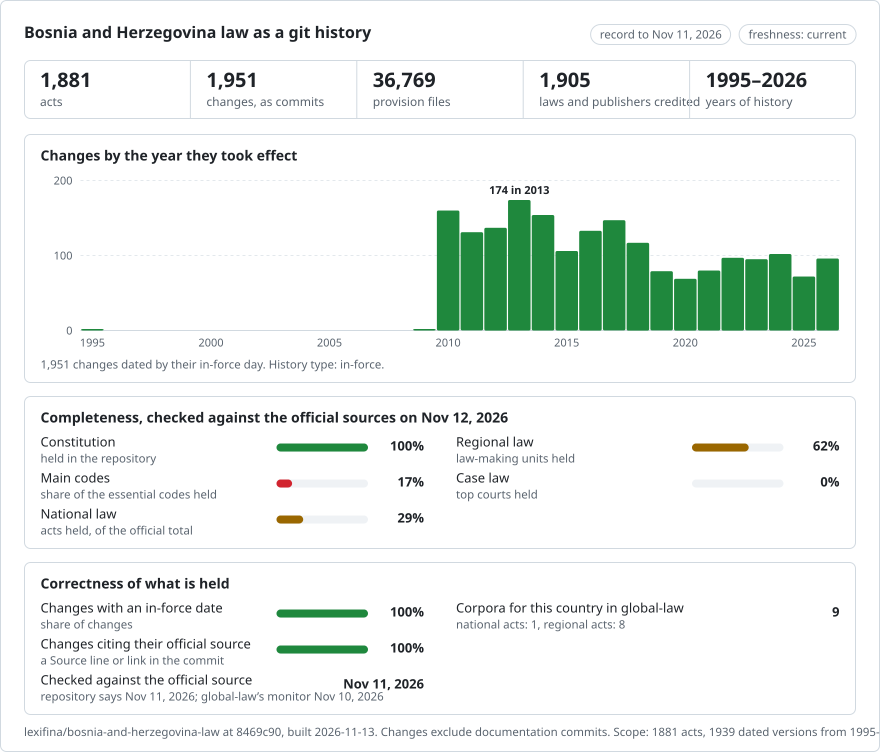

# Bosnia and Herzegovina: law history in git

[Bosanski](README.md) · **English**

<picture>
<source media="(prefers-color-scheme: dark)" srcset="data/effort-dark.svg">

</picture>

Part of [lexifina/global-law](https://github.com/lexifina/global-law), one git history for every country's law: this is Bosnia and Herzegovina's national (state-level) law, which global-law reads at `bosnia-and-herzegovina/national/acts/`.

The law of the state of Bosnia and Herzegovina as a git repository: one file per article, one commit per act on the day it took effect, so `git blame` and `git log` work on the text. The law of the entities, the Brčko District and the cantons is in separate repositories (`lexifina/bosnia-federation-law`, `lexifina/bosnia-republika-srpska-law`, `lexifina/bosnia-brcko-law` and the canton repositories).

**What is in it now**

| Folder | Law | Versions | History |
| --- | --- | ---: | --- |
| `constitution/` | Constitution of Bosnia and Herzegovina (Annex 4 to the General Framework Agreement for Peace, Dayton/Paris) | 1 | As signed on 14 December 1995 (English, the authentic text) |
| `criminal-code/` | Criminal Code of Bosnia and Herzegovina (2003), unofficial consolidated English text to Official Gazette 47/14 | 1 | Oldest version available: the Prosecutor's Office of BiH file, dated 4 May 2017 |
| `zakon/`, `pravilnik/`, `uputstvo/`, `poslovnik/`, `pravilo/` | 1,879 acts published in Službeni glasnik BiH: laws of the Parliamentary Assembly, and the rulebooks, instructions, rules of procedure and rules of state institutions | one per act, plus each official consolidated text of it, and its repeal where it reads cleanly | As published in the Gazette, in Bosnian, each on the in-force day its own final article names; a consolidated text on its issue day |

Every act is listed, with its kind, number, status and span, in [registry/ACTS.md](registry/ACTS.md) and [registry/data/acts.json](registry/data/acts.json); `registry/data/paths.json` maps each act id to its folder (`<kind>/<year>/sg<issue>-<id>`). How the Gazette acts were read and built is in [registry/REPRODUCE.md](registry/REPRODUCE.md). What is planned, part by part, and how much of each part is published is in [PLAN.md](PLAN.md).

## Dates and limits

- **Constitution.** One version, dated 14 December 1995: under Article XII(1) it entered into force on signature of the General Framework Agreement. Amendment I (26 March 2009, Brčko District; Službeni glasnik BiH 25/09) is not in this record: the source is the Constitutional Court's English PDF of 2006. Files: `art-01.md` is Article I, `annex-ii.md` is Annex II, `preamble.md` the preamble; the PDF's own typesetting is kept.
- **Criminal Code.** The English consolidation posted by the Prosecutor's Office of BiH, which labels it unofficial; the Official Gazette text in the local languages prevails. It runs to amendment 47/14, so later amendments are not in it. Civil and commercial law is made by the entities and the Brčko District, not by the state.
- **Gazette acts.** Each act is published as the Gazette printed it. Some issuing bodies (the Central Election Commission most often, also ministries and the Parliamentary Assembly) publish an official consolidated text ("prečišćeni tekst") of an act in the Gazette: that text is a later version of the act it consolidates (the act its own "obuhvata ..." article names first), in force from its issue day, and credited to the consolidated text itself, since it does not say which amending act changed each provision. When the act it consolidates has no text the publisher serves (1997-2009), the first consolidated text is the act's oldest version available. An act that a later act amends, repeals, corrects or cites with its amendments (after its newest consolidated text, if any) is still published as enacted, and labelled `amended, not consolidated` (or `repealed, not consolidated`) in `registry/data/acts.json`, with the acts that change it (`amended_by`, each with its official link); the change itself is not applied to its text. A repeal is applied (a last, empty version) only when one later act repeals the whole act on its own in-force day.
- Every version names the official page it was read from (commit trailers `Source:`; `portal` in `registry/data/acts.json`), so every act can be checked against its source.
- Acts listed in the Gazette but held back (their text does not split cleanly into articles, their in-force day cannot be read, or their Bosnian text is not served) are listed with the reason in [data/held.json](data/held.json); acts published but not yet in force are in [data/pending.json](data/pending.json) and are appended on their day.

## Freshness

<!-- freshness-summary -->
Checked against the official sources: 2026-11-10; 100% of acts verified in the last 7 days, 100% in the last 30 ([data/freshness.json](data/freshness.json)).
<!-- /freshness-summary -->

`python tools/freshness.py <act>` gives an act's status, its last check and the official link. A refresh runner reads every new issue of Službeni glasnik BiH daily, appends new acts, labels acts that a new act changes, and re-checks every act within its threshold (7 days for the Constitution, the Criminal Code and laws; 30 days for regulations); [data/status.json](data/status.json) says whether updates are running and whether the official source is answering. Statuses and fields: [data/freshness.json](data/freshness.json).

## Source

Službeni glasnik BiH, as shown by JP NIO Službeni list BiH (https://www.sluzbenilist.ba): every issue's list of acts and each act's Bosnian text. Prosecutor's Office of Bosnia and Herzegovina (https://www.tuzilastvobih.gov.ba), Criminal Code consolidated text, retrieved 30 October 2026. Constitutional Court of Bosnia and Herzegovina (https://www.ustavnisud.ba), Constitution of Bosnia and Herzegovina, English PDF, retrieved 29 October 2026. Official texts of laws are not protected by copyright in Bosnia and Herzegovina.

No AI model wrote or changed legal text. This is not legal advice and not an official publication; for anything that matters, read the original.

## More

From [lexifina/global-law](https://github.com/lexifina/global-law):

- [FEATURES.md](https://github.com/lexifina/global-law/blob/main/FEATURES.md): every feature, and what every corpus must support (`git blame`, `law.py`, the MCP tools)
- [FAQ.md](https://github.com/lexifina/global-law/blob/main/FAQ.md): questions and answers · [CONTRIBUTING.md](https://github.com/lexifina/global-law/blob/main/CONTRIBUTING.md): proposing changes · [MCP.md](https://github.com/lexifina/global-law/blob/main/MCP.md): the MCP server · [REPRODUCE.md](https://github.com/lexifina/global-law/blob/main/REPRODUCE.md): how it was built · [CHANGELOG.md](https://github.com/lexifina/global-law/blob/main/CHANGELOG.md)
- [FRESHNESS.md](https://github.com/lexifina/global-law/blob/main/FRESHNESS.md): how current each corpus is · [Monitoring](https://github.com/lexifina/global-law/tree/main/monitoring): whether updates are running · [WATCHING.md](https://github.com/lexifina/global-law/blob/main/WATCHING.md): how each official source is watched for changes
- [performance/](https://github.com/lexifina/global-law/tree/main/performance): how fast the tools are, measured
- [visualisations/](https://github.com/lexifina/global-law/tree/main/visualisations): charts and bridges across the world's law
- [Vulnerabilities](https://github.com/lexifina/global-law/tree/main/vulnerabilities): mistakes in legislation as published
