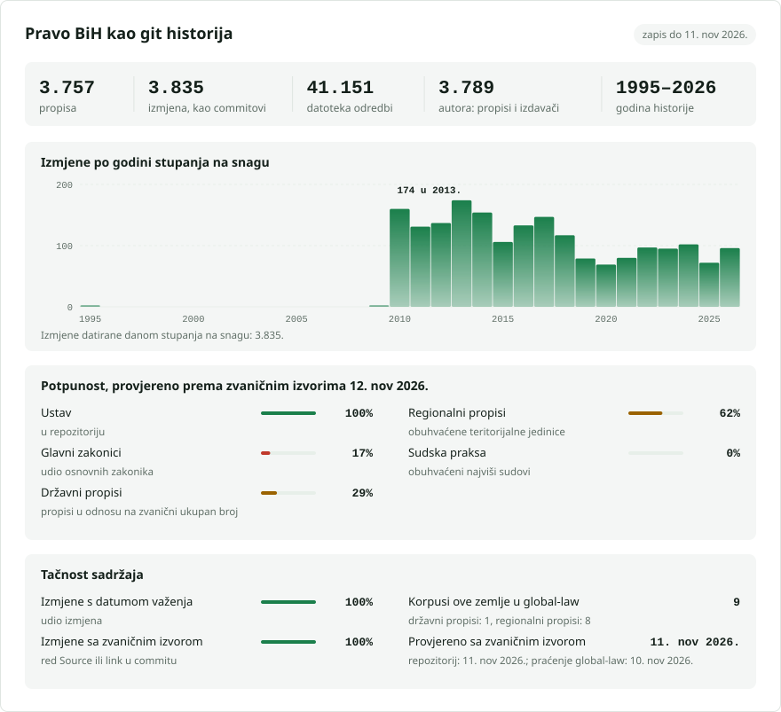

# Bosna i Hercegovina: historija propisa u gitu

**Bosanski** · **[Or read it in English](README.en.md)**

<picture>
<source media="(prefers-color-scheme: dark)" srcset="data/bs/effort-dark.svg">

</picture>

Pravo države Bosne i Hercegovine kao git historija: jedna datoteka po članu, jedan commit po verziji na dan kada je stupila na snagu, a autor svakog commita je propis koji je objavio tu verziju. `git blame` pokazuje propis koji stoji iza svakog reda; `git log` navodi svaku izmjenu člana; izborom datuma dobija se tekst koji je tog dana bio na snazi.

Dio projekta [lexifina/global-law](https://github.com/lexifina/global-law), jedne git historije prava svih zemalja: ovo je pravo Bosne i Hercegovine na državnom nivou, koje global-law čita na putanji `bosnia-and-herzegovina/national/acts/`. Pravo entiteta i Brčko distrikta nalazi se u repozitorijima [bosnia-federation-law](https://github.com/lexifina/bosnia-federation-law), [bosnia-republika-srpska-law](https://github.com/lexifina/bosnia-republika-srpska-law), [bosnia-brcko-law](https://github.com/lexifina/bosnia-brcko-law) i u repozitorijima kantona.

**Šta sadrži sada:** Ustav, Krivični zakon i 1.875 propisa objavljenih u Službenom glasniku BiH od 2010. do 2026. (199 zakona Parlamentarne skupštine i 1.676 pravilnika, uputstava, poslovnika i pravila državnih institucija), od kojih 21 ima kasniji službeni prečišćeni tekst, a 37 završava stavljanjem van snage. [`PLAN.md`](PLAN.md) navodi sve dijelove koje ovaj repozitorij treba da sadrži i dokle se stiglo sa svakim; [`registry/ACTS.md`](registry/ACTS.md) navodi sve propise iz Glasnika, po vrsti.

Svaki propis iz Glasnika je u `<kind>/<year>/sg<issue>-<id>/`, prema broju Glasnika u kojem je objavljen (`zakon/2010/sg012-183639/` je Zakon Bosne i Hercegovine o izvršenju krivičnih sankcija, pritvora i drugih mjera, u službenom prečišćenom tekstu objavljenom u „Službenom glasniku BiH” 12/2010). Ustav je u [`constitution/`](constitution/), a Krivični zakon u [`criminal-code/`](criminal-code/). `registry/data/paths.json` povezuje id svakog propisa s njegovim folderom.

Propisi iz Glasnika su na bosanskom jeziku, latinicom, onako kako ih objavljuje Službeni list BiH (Glasnik ih objavljuje i na hrvatskom i srpskom jeziku). Ustav je na engleskom, jeziku njegovog autentičnog teksta, a Krivični zakon u nezvaničnom prečišćenom tekstu na engleskom. Prijevod propisa iz Glasnika na engleski nije dio ovog repozitorija.

## Pitanja kao git komande

| Pitanje | Komanda |
| --- | --- |
| Svaka izmjena člana 1 Zakona o izvršenju krivičnih sankcija | `git log -p --word-diff -- zakon/2010/sg012-183639/art-001.md` |
| Koji propis je napisao svaki red člana 1? | `git blame zakon/2010/sg012-183639/art-001.md` |
| Svaka verzija zakona, s danom kada je stupila na snagu | `git log --format="%h %(trailers:key=In-force,valueonly,separator=) %an" -- zakon/2010/sg012-183639` |
| Član 1 kako je glasio 1. januara 2015. | `python tools/on.py 2015-01-01 zakon/2010/sg012-183639 art-001` |

**Izvan gita** ove podatke također objavljujemo javno i besplatno:

- **[Pitajte Claude o pravu Bosne i Hercegovine](https://global-law.lexifina.com/v1/try_claude?country=bosnia-and-herzegovina)**: otvara Claude sa spremnim prvim pitanjem.
- **[Pitajte ChatGPT](https://global-law.lexifina.com/v1/try_chatgpt?country=bosnia-and-herzegovina)**: isto pitanje u ChatGPT-u.
- **[Pozovite API u pregledniku](https://global-law.lexifina.com/v1/search_law?query=godi%C5%A1nji+odmor&jurisdictions=bosnia-and-herzegovina)**: pretraga prava Bosne i Hercegovine za „godišnji odmor”, odgovor u JSON-u. Dokumentacija je [ovdje](https://lexifina.com/api/global-law).

Oba asistenta čitaju podatke preko besplatnog konektora Global law (MCP, `https://global-law.lexifina.com/mcp`); prvi put razgovor daje link kojim se konektor dodaje. Pitajte na bosanskom, hrvatskom ili srpskom, ili na engleskom.

**Lako ga pokrenite sami.** Dovoljni su git i Python, a alati rade na vašem računaru:

```sh
git clone --depth 1 https://github.com/lexifina/global-law && cd global-law
python3 tools/countries.py add bosnia-and-herzegovina/national/acts
python3 tools/law.py show 2026-01-01 bosnia-and-herzegovina/national/acts/zakon/2010/sg012-183639/art-001.md
```

Otvoren u Claude Code-u, Cursoru, VS Code-u ili Codexu, klon pokreće i lokalni MCP server s istim alatima ([MCP.md](https://github.com/lexifina/global-law/blob/main/MCP.md)).

## Datumi

Svaki commit nosi datum u podne po sarajevskom vremenu (Europe/Sarajevo), na dan kada je verzija stupila na snagu, a taj dan stoji i u njegovom `In-force:` traileru:

- za propis iz Glasnika, dan koji navodi njegov vlastiti završni član, gotovo uvijek osmi dan od objavljivanja;
- za službeni prečišćeni tekst, dan izlaska broja Glasnika: to je kasnija verzija propisa koji prečišćava;
- za stavljanje van snage, posljednja, prazna verzija na dan stupanja na snagu propisa koji ga stavlja van snage, samo kada jedan kasniji propis stavi van snage cijeli propis;
- za Ustav, 14. decembar 1995. (član XII(1): stupa na snagu potpisivanjem Općeg okvirnog sporazuma); za Krivični zakon, 4. maj 2017., datum datoteke Tužilaštva.

Svaka verzija pripisuje se propisu koji ju je objavio, onako kako ga Glasnik naziva. Prečišćeni tekst pripisuje se samom sebi, jer ne navodi koji je propis o izmjenama promijenio koju odredbu; kada je propis koji prečišćava iz perioda 1997-2009, za koji izdavač ne nudi tekst, to je „najstarija dostupna verzija”, pripisana JP NIO Službeni list Bosne i Hercegovine.

## Koliko je ažurno

<!-- freshness-summary -->
Provjereno prema zvaničnim izvorima: 2026-11-10; 100% propisa provjereno u posljednjih 7 dana, 100% u posljednjih 30 ([data/freshness.json](data/freshness.json)).
<!-- /freshness-summary -->

Proces osvježavanja čita svaki novi broj Službenog glasnika BiH, dodaje nove propise i ponovo provjerava svaki propis u roku od 7 dana (zakoni) ili 30 dana (podzakonski propisi); [data/status.json](data/status.json) pokazuje da li ažuriranja rade, a `python tools/freshness.py <act>` daje status i zvanični link jednog propisa.

## Kako se provjerava

- Svaka verzija navodi zvaničnu stranicu s koje je pročitana (trailer commita `Source:` ili `Consolidated:`; `portal` u `registry/data/acts.json`), tako da se svaki propis može provjeriti prema izvoru.
- Propisi čiji se tekst ne dijeli čisto na članove ili čiji se dan stupanja na snagu ne može pročitati zadržavaju se umjesto da se pogađa, svaki s razlogom u [data/held.json](data/held.json).
- `registry/tools/build/check_repo.py` čita svaku verziju iz gita i poredi je s korpusom; isti korpus uvijek daje iste hasheve commitova. Hashevi korpusa i alata za izgradnju su u `registry/REPRODUCE.md`.
- Duplikati pronađeni naknadno povlače se novim commitom (`withdrawn_by` u `registry/data/acts.json`); nijedan objavljeni commit se ne prepravlja.

## Šta ne prikazuje

- **Izmjene u tekstu.** Propis koji kasniji propis mijenja zadržan je onako kako je donesen i označen kao `amended, not consolidated` (235 propisa) ili `repealed, not consolidated` (52) u `registry/data/acts.json`, s propisima koji ga mijenjaju. Kasnije verzije daju samo službeni prečišćeni tekstovi.
- **Propise iz perioda 1997-2009.** Izdavač za njih ne nudi besplatan tekst: 1.284 propisa koje Glasnik navodi nisu ovdje. Još 495 propisa iz perioda 2010-2026 je zadržano; svih 1.779 navedeno je u [data/held.json](data/held.json). Ovdje je 1.875 od 3.654 propisa planiranih vrsta.
- **Amandman I na Ustav** (2009, Brčko distrikt), kojeg nema u engleskom tekstu Ustavnog suda iz 2006., i **izmjene Krivičnog zakona nakon 47/14**, kojih nema u korištenom prečišćenom tekstu.
- **Sudsku praksu** (planirana je drugdje) i **pravo entiteta, Brčko distrikta i kantona**, koji donose građansko i privredno pravo (u gore navedenim repozitorijima).

## Izvori

| Izvor | Vrsta | Ranije verzije | Napomene |
| --- | --- | --- | --- |
| [Službeni list BiH](https://www.sluzbenilist.ba) (JP NIO Službeni list Bosne i Hercegovine) | Službeni glasnik BiH | službeni prečišćeni tekstovi, kada ih Glasnik objavi | Popis propisa svakog broja i bosanski tekst svakog propisa, 2010-2026 |
| [Ustavni sud BiH](https://www.ustavnisud.ba) | Ustav Bosne i Hercegovine | ne | Engleski tekst Suda, kako je potpisan 1995. |
| [Tužilaštvo BiH](https://www.tuzilastvobih.gov.ba) | Krivični zakon Bosne i Hercegovine | ne | Nezvanični prečišćeni tekst na engleskom, zaključno sa „Službenim glasnikom BiH” 47/14 |

## Licenca

Vidi [`LICENSE`](LICENSE). Tekstovi propisa su zvanični tekstovi, koji u Bosni i Hercegovini nisu zaštićeni autorskim pravom, preneseni bez izmjena osim prijeloma; raspored, tabele, poruke commitova i alati su djelo Lexifine pod licencom CC BY 4.0.

Nijedan AI model nije pisao, prevodio niti mijenjao tekst propisa; skripte je napisao AI model (vidi [`REPRODUCE.md`](REPRODUCE.md) i [`registry/REPRODUCE.md`](registry/REPRODUCE.md)).

Ovo je prijevod engleske verzije ([README.en.md](README.en.md)); ako se razlikuju, važi engleska verzija.

## Više

Iz repozitorija [lexifina/global-law](https://github.com/lexifina/global-law) (na engleskom):

- [FEATURES.md](https://github.com/lexifina/global-law/blob/main/FEATURES.md): sve funkcije i šta svaki korpus mora podržavati (`git blame`, `law.py`, MCP alati)
- [FAQ.md](https://github.com/lexifina/global-law/blob/main/FAQ.md): pitanja i odgovori · [CONTRIBUTING.md](https://github.com/lexifina/global-law/blob/main/CONTRIBUTING.md): predlaganje izmjena · [MCP.md](https://github.com/lexifina/global-law/blob/main/MCP.md): MCP server · [REPRODUCE.md](https://github.com/lexifina/global-law/blob/main/REPRODUCE.md): kako je napravljen · [CHANGELOG.md](https://github.com/lexifina/global-law/blob/main/CHANGELOG.md)
- [FRESHNESS.md](https://github.com/lexifina/global-law/blob/main/FRESHNESS.md): koliko je ažuran svaki korpus · [Praćenje](https://github.com/lexifina/global-law/tree/main/monitoring): da li ažuriranja rade · [WATCHING.md](https://github.com/lexifina/global-law/blob/main/WATCHING.md): kako se svaki zvanični izvor prati zbog izmjena
- [performance/](https://github.com/lexifina/global-law/tree/main/performance): koliko su alati brzi, izmjereno
- [visualisations/](https://github.com/lexifina/global-law/tree/main/visualisations): grafikoni i veze kroz pravo cijelog svijeta
- [Ranjivosti](https://github.com/lexifina/global-law/tree/main/vulnerabilities): greške u propisima onako kako su objavljeni
