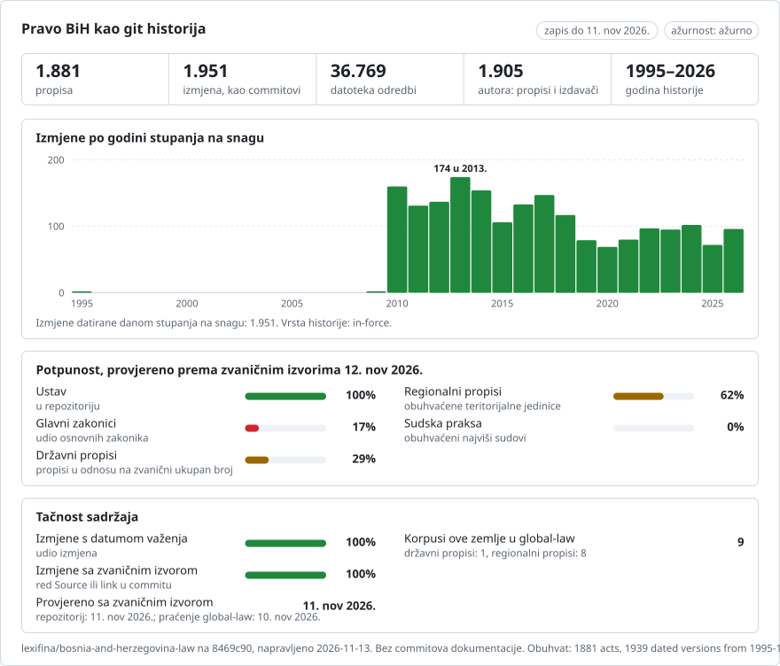

# Bosna i Hercegovina: historija propisa u gitu

**Bosanski** · [English](README.en.md)

<picture>
<source media="(prefers-color-scheme: dark)" srcset="data/bs/effort-dark.svg">

</picture>

Dio projekta [lexifina/global-law](https://github.com/lexifina/global-law), jedne git historije prava svih zemalja: ovo je nacionalno (državno) pravo Bosne i Hercegovine, koje global-law čita na putanji `bosnia-and-herzegovina/national/acts/`.

Pravo države Bosne i Hercegovine kao git repozitorij: jedna datoteka po članu, jedan commit po propisu na dan kada je stupio na snagu, tako da `git blame` i `git log` rade na tekstu. Pravo entiteta, Brčko distrikta i kantona nalazi se u zasebnim repozitorijima (`lexifina/bosnia-federation-law`, `lexifina/bosnia-republika-srpska-law`, `lexifina/bosnia-brcko-law` i repozitoriji kantona).

**Šta sadrži sada**

| Folder | Propis | Verzije | Historija |
| --- | --- | ---: | --- |
| `constitution/` | Ustav Bosne i Hercegovine (Aneks 4 Općeg okvirnog sporazuma za mir, Dayton/Pariz) | 1 | Kako je potpisan 14. decembra 1995. (na engleskom, autentični tekst) |
| `criminal-code/` | Krivični zakon Bosne i Hercegovine (2003), nezvanični prečišćeni tekst na engleskom, zaključno sa Službenim glasnikom 47/14 | 1 | Najstarija dostupna verzija: datoteka Tužilaštva BiH s datumom 4. maja 2017. |
| `zakon/`, `pravilnik/`, `uputstvo/`, `poslovnik/`, `pravilo/` | 1.879 propisa objavljenih u Službenom glasniku BiH: zakoni Parlamentarne skupštine te pravilnici, uputstva, poslovnici i pravila državnih institucija | jedna po propisu, uz svaki njegov službeni prečišćeni tekst i njegovo stavljanje van snage ako se može čisto pročitati | Kako su objavljeni u Glasniku, na bosanskom, svaki na dan stupanja na snagu koji navodi njegov vlastiti završni član; prečišćeni tekst na dan izlaska broja |

Svaki propis je naveden, s vrstom, brojem, statusom i vremenskim rasponom, u [registry/ACTS.md](registry/ACTS.md) i [registry/data/acts.json](registry/data/acts.json); `registry/data/paths.json` povezuje id svakog propisa s njegovim folderom (`<kind>/<year>/sg<issue>-<id>`). Kako su propisi iz Glasnika pročitani i izgrađeni opisano je u [registry/REPRODUCE.md](registry/REPRODUCE.md). Šta je planirano, dio po dio, i koliko je svakog dijela objavljeno navodi [PLAN.md](PLAN.md).

## Datumi i ograničenja

- **Ustav.** Jedna verzija, s datumom 14. decembra 1995.: prema članu XII(1) stupio je na snagu potpisivanjem Općeg okvirnog sporazuma. Amandman I (26. marta 2009., Brčko distrikt; Službeni glasnik BiH 25/09) nije u ovom zapisu: izvor je PDF Ustavnog suda na engleskom iz 2006. Datoteke: `art-01.md` je član I, `annex-ii.md` je Aneks II, `preamble.md` preambula; zadržan je prijelom samog PDF-a.
- **Krivični zakon.** Prečišćeni tekst na engleskom koji je objavilo Tužilaštvo BiH, koje ga označava kao nezvaničan; mjerodavan je tekst Službenog glasnika na lokalnim jezicima. Obuhvata izmjene zaključno sa 47/14, pa kasnije izmjene nisu u njemu. Građansko i privredno pravo donose entiteti i Brčko distrikt, a ne država.
- **Propisi iz Glasnika.** Svaki propis je objavljen onako kako ga je Glasnik odštampao. Neki donosioci (najčešće Centralna izborna komisija, ali i ministarstva i Parlamentarna skupština) objavljuju u Glasniku službeni „prečišćeni tekst” propisa: taj tekst je kasnija verzija propisa koji prečišćava (propisa koji njegov član „obuhvata ...” navodi prvi), na snazi je od dana izlaska broja i pripisuje se samom prečišćenom tekstu, jer ne navodi koji je propis o izmjenama promijenio koju odredbu. Kada propis koji prečišćava nema tekst koji izdavač nudi (1997-2009), prvi prečišćeni tekst je najstarija dostupna verzija propisa. Propis koji kasniji propis mijenja, stavlja van snage, ispravlja ili navodi zajedno s njegovim izmjenama (nakon njegovog najnovijeg prečišćenog teksta, ako ga ima) i dalje je objavljen onako kako je donesen i označen kao `amended, not consolidated` (ili `repealed, not consolidated`) u `registry/data/acts.json`, s propisima koji ga mijenjaju (`amended_by`, svaki sa svojim službenim linkom); sama izmjena se ne primjenjuje na njegov tekst. Stavljanje van snage se primjenjuje (posljednja, prazna verzija) samo kada jedan kasniji propis samostalno stavi van snage cijeli propis na dan svog stupanja na snagu.
- Svaka verzija navodi zvaničnu stranicu s koje je pročitana (traileri commita `Source:`; `portal` u `registry/data/acts.json`), tako da se svaki propis može provjeriti prema izvoru.
- Propisi navedeni u Glasniku, ali zadržani (njihov tekst se ne dijeli čisto na članove, njihov dan stupanja na snagu ne može se pročitati ili njihov bosanski tekst nije dostupan) navedeni su s razlogom u [data/held.json](data/held.json); propisi koji su objavljeni, ali još nisu stupili na snagu, nalaze se u [data/pending.json](data/pending.json) i dodaju se na svoj dan.

## Ažurnost

<!-- freshness-summary -->
Provjereno prema zvaničnim izvorima: 2026-11-10; 100% propisa provjereno u posljednjih 7 dana, 100% u posljednjih 30 ([data/freshness.json](data/freshness.json)).
<!-- /freshness-summary -->

`python tools/freshness.py <act>` daje status propisa, njegovu posljednju provjeru i zvanični link. Proces osvježavanja svakodnevno čita svaki novi broj Službenog glasnika BiH, dodaje nove propise, označava propise koje novi propis mijenja i ponovo provjerava svaki propis u okviru njegovog praga (7 dana za Ustav, Krivični zakon i zakone; 30 dana za podzakonske propise); [data/status.json](data/status.json) pokazuje da li ažuriranja rade i da li zvanični izvor odgovara. Statusi i polja: [data/freshness.json](data/freshness.json).

## Izvor

Službeni glasnik BiH, kako ga prikazuje JP NIO Službeni list BiH (https://www.sluzbenilist.ba): popis propisa svakog broja i bosanski tekst svakog propisa. Tužilaštvo Bosne i Hercegovine (https://www.tuzilastvobih.gov.ba), prečišćeni tekst Krivičnog zakona, preuzeto 30. oktobra 2026. Ustavni sud Bosne i Hercegovine (https://www.ustavnisud.ba), Ustav Bosne i Hercegovine, PDF na engleskom, preuzeto 29. oktobra 2026. Zvanični tekstovi zakona u Bosni i Hercegovini nisu zaštićeni autorskim pravom.

Nijedan AI model nije pisao niti mijenjao tekst propisa. Ovo nije pravni savjet niti zvanična publikacija; za sve što je važno, pročitajte izvornik.

Ovo je prijevod engleske verzije ([README.en.md](README.en.md)); ako se razlikuju, važi engleska verzija.

## Više

Iz repozitorija [lexifina/global-law](https://github.com/lexifina/global-law) (na engleskom):

- [FEATURES.md](https://github.com/lexifina/global-law/blob/main/FEATURES.md): sve funkcije i šta svaki korpus mora podržavati (`git blame`, `law.py`, MCP alati)
- [FAQ.md](https://github.com/lexifina/global-law/blob/main/FAQ.md): pitanja i odgovori · [CONTRIBUTING.md](https://github.com/lexifina/global-law/blob/main/CONTRIBUTING.md): predlaganje izmjena · [MCP.md](https://github.com/lexifina/global-law/blob/main/MCP.md): MCP server · [REPRODUCE.md](https://github.com/lexifina/global-law/blob/main/REPRODUCE.md): kako je napravljen · [CHANGELOG.md](https://github.com/lexifina/global-law/blob/main/CHANGELOG.md)
- [FRESHNESS.md](https://github.com/lexifina/global-law/blob/main/FRESHNESS.md): koliko je ažuran svaki korpus · [Praćenje](https://github.com/lexifina/global-law/tree/main/monitoring): da li ažuriranja rade · [WATCHING.md](https://github.com/lexifina/global-law/blob/main/WATCHING.md): kako se svaki zvanični izvor prati zbog izmjena
- [performance/](https://github.com/lexifina/global-law/tree/main/performance): koliko su alati brzi, izmjereno
- [visualisations/](https://github.com/lexifina/global-law/tree/main/visualisations): grafikoni i veze kroz pravo cijelog svijeta
- [Ranjivosti](https://github.com/lexifina/global-law/tree/main/vulnerabilities): greške u propisima onako kako su objavljeni
