# The law of Bosnia and Herzegovina in 20 charts

[Bosanski](README.md) · **English**

Charts on every country's law, from the whole of global-law: [global-law visualisations/](https://github.com/lexifina/global-law/tree/main/visualisations). These are the charts on Bosnia and Herzegovina alone.

Twenty charts on the law of Bosnia and Herzegovina, drawn only from the data in this repository: every act in the issue lists of Službeni glasnik BiH since 1997, the acts whose text is here, the Constitution, the High Representative's decisions, the bills that were not adopted, the Constitutional Court's database of decisions and the cases of the Court of Bosnia and Herzegovina.

Open [`pravo-bosne-i-hercegovine-u-20-grafikona.html`](pravo-bosne-i-hercegovine-u-20-grafikona.html) in a browser. The page is one file with all its data inside; it loads only the d3 library and its fonts from the web. The controls at the top right switch the language (Bosnian or English) and the theme (light or dark). Each chart names its data path in the repository, its record count and its limits, and has a table of every number under it. Hover over a mark for the exact values.

The charts are descriptive: they show what the sources record, not why.

## The charts

### I. The Official Gazette, 1997–2026

#### 1. Službeni glasnik BiH

Every act in the Gazette since 1997 by kind: 31,153 acts, 706 of them laws.

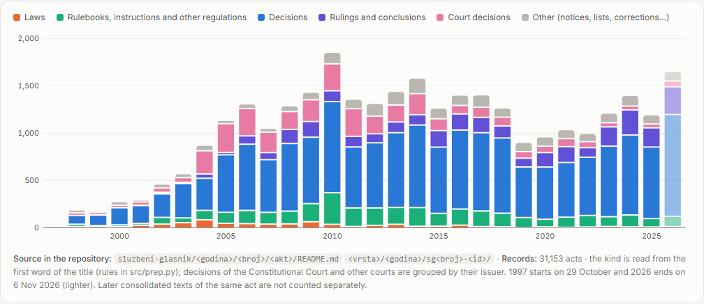

#### 2. Who publishes in the Gazette

Issuers by year, from the Council of Ministers and the High Judicial and Prosecutorial Council to the Central Bank.

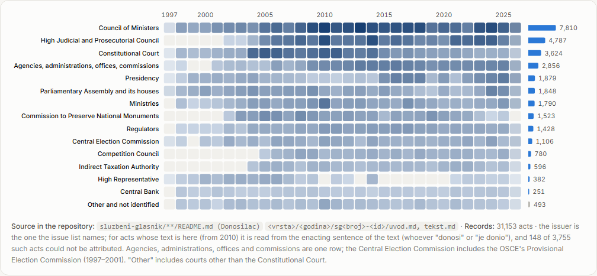

#### 3. When acts take effect

Laws on the eighth day after publication, decisions most often before they are published.

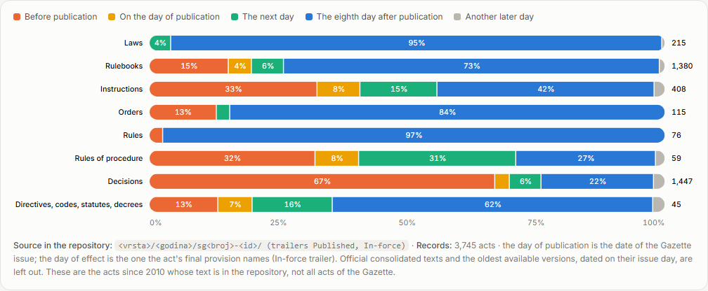

#### 4. Acts since 2010

What became of the 1,875 acts whose text is here: amendments without an official consolidated text, and repeals.

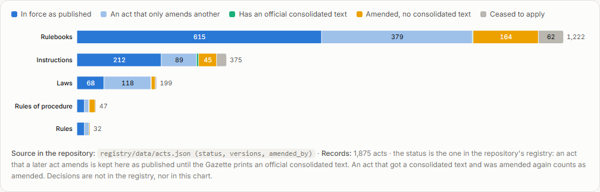

### II. The Dayton Constitution and the High Representative

#### 5. The Constitution (Annex 4)

How often each part of the Constitution names the Entities, the constituent peoples, Others and citizens.

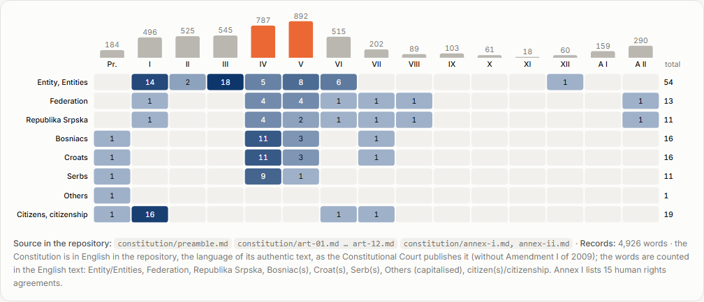

#### 6. The High Representative in the Gazette

380 acts of the High Representative, by term and by kind of act.

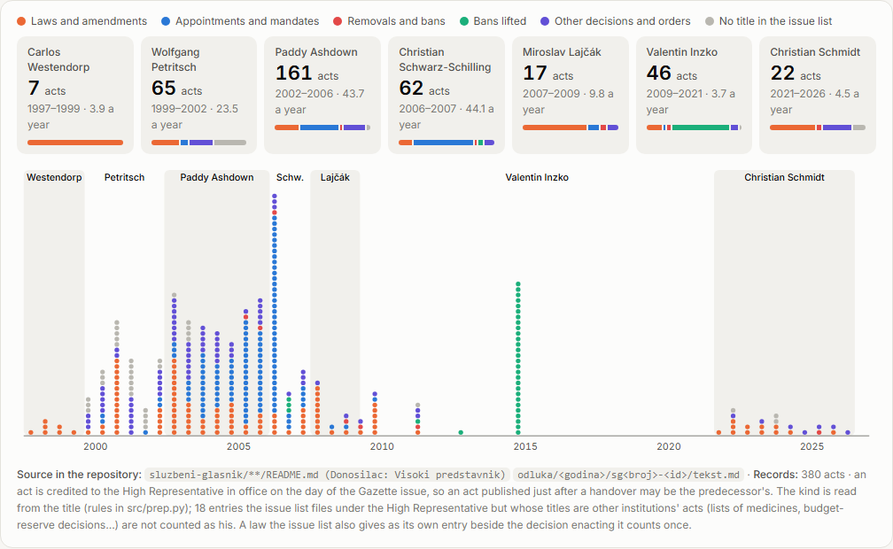

#### 7. The most-amended laws

Amendments to 14 laws by year and by who made them; the Election Law 24 times since 2001.

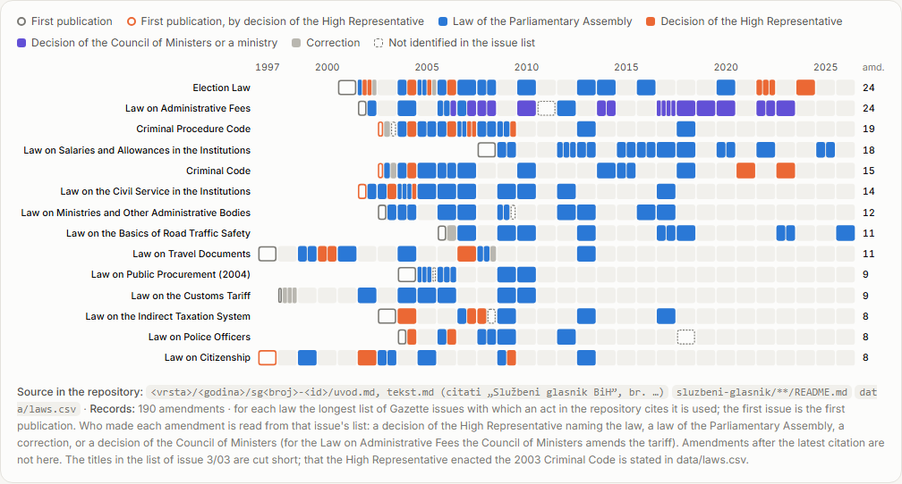

### III. The Parliamentary Assembly, the budget and taxes

#### 8. Who makes the laws

Laws of the Parliamentary Assembly and laws enacted by the High Representative, by year.

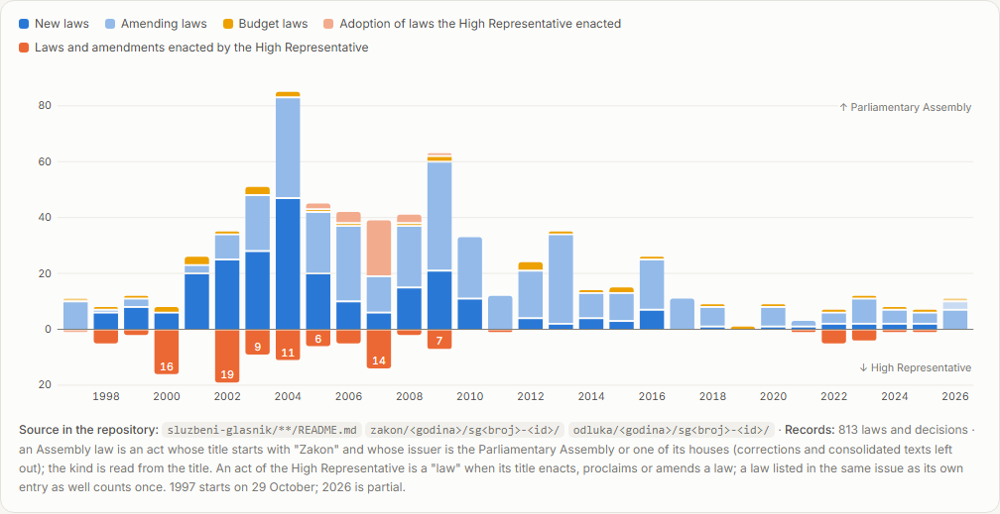

#### 9. Two houses, one text

The days between a law's adoption in the House of Representatives and in the House of Peoples.

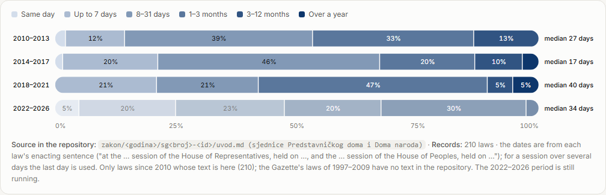

#### 10. Bills that never became law, 2004–2015

233 bills that were not adopted, by proposer and outcome, and the six proposals to amend the Constitution.

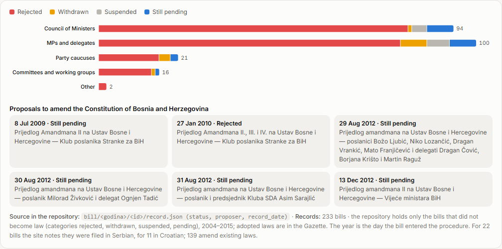

#### 11. The state budget

When the Gazette published each year's budget law, against 1 January of that year.

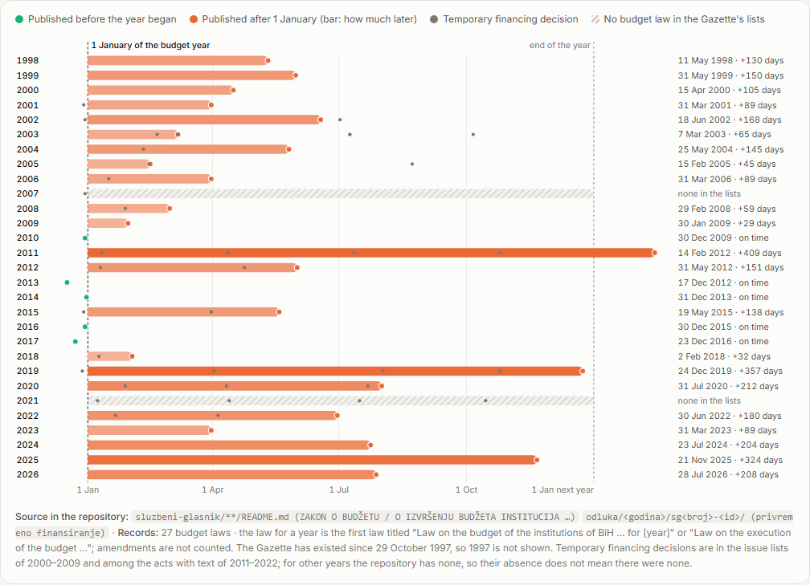

#### 12. The budget reserve

Decisions on the funds of the current reserve by issuer: the Council of Ministers, the Presidency, the houses' collegiums.

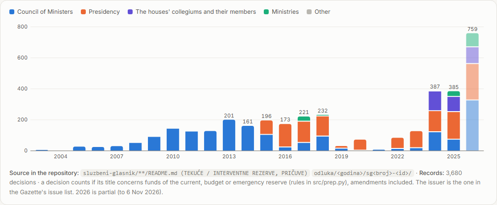

#### 13. The cigarette excise

The specific and minimum excise and the reference price of a pack, 2011–2027.

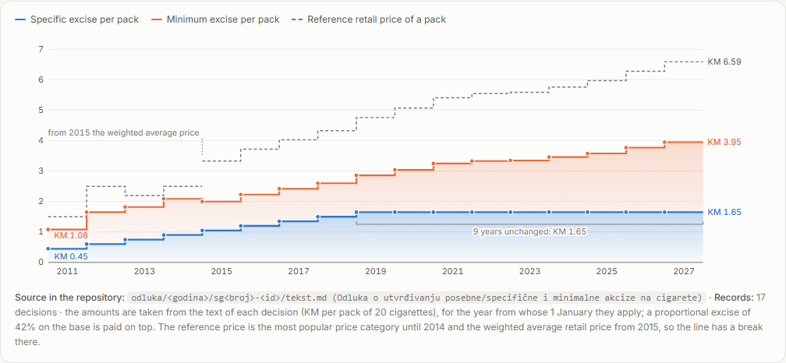

### IV. The Constitutional Court

#### 14. The Constitutional Court

53,975 decisions from the Court's database by year and kind.

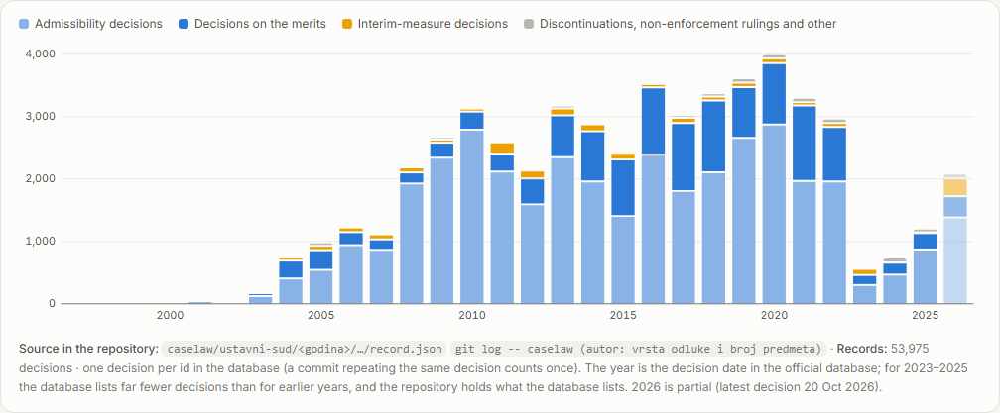

#### 15. Waiting for a decision on the merits

How many years appeals waited for a decision on the merits, by period.

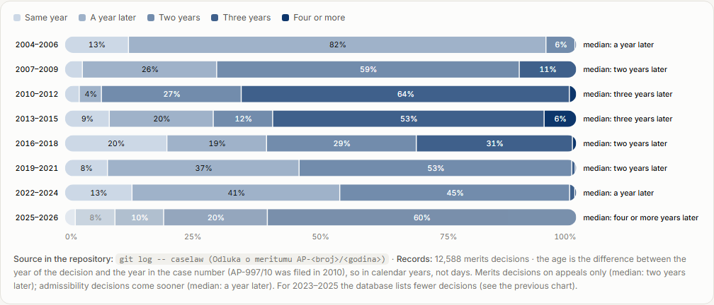

#### 16. Rulings on non-enforcement

176 rulings by which the Court found that one of its decisions had not been enforced.

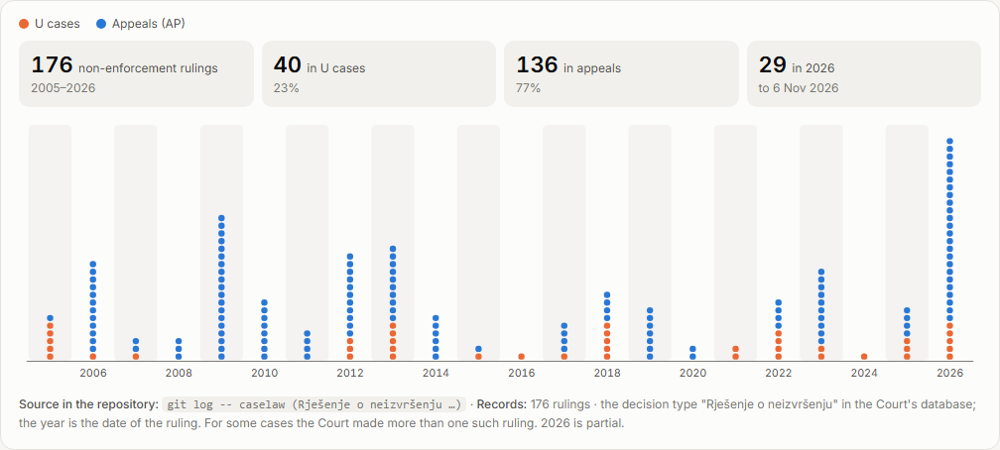

### V. The Court of Bosnia and Herzegovina and the High Judicial and Prosecutorial Council

#### 17. The Court of BiH

Cases by the year the indictment was confirmed and by section of the Court.

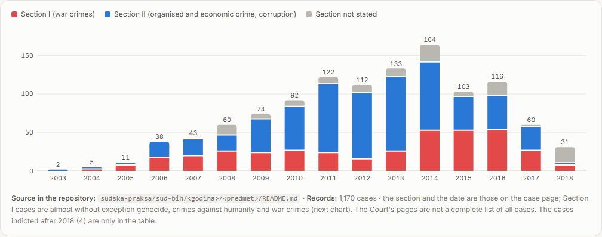

#### 18. What the indictments charge

The first offence an indictment names, by section.

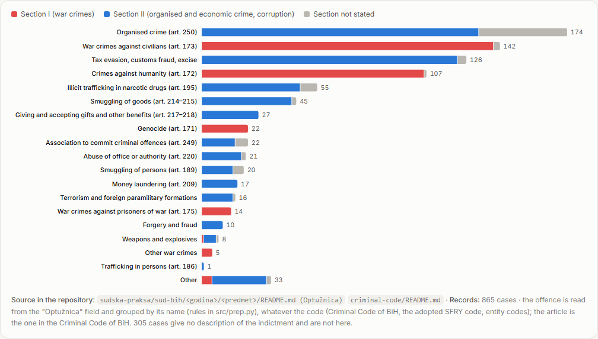

#### 19. From confirmed indictment to final judgment

The median duration by year of indictment: war crimes against Section II.

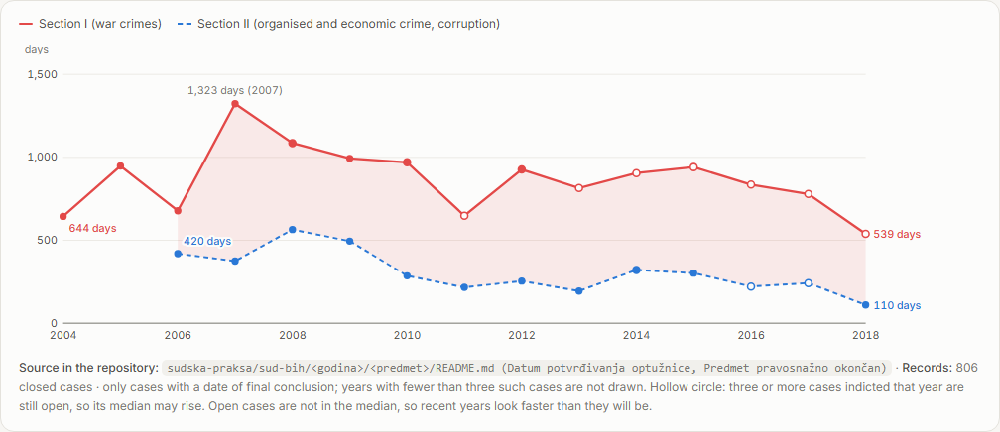

#### 20. One council appoints the judges and prosecutors of the whole country

The High Judicial and Prosecutorial Council's appointments in the Federation of BiH, Republika Srpska, at state level and in Brčko District.

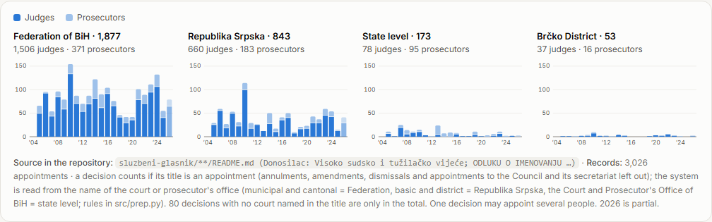

## Data

| Dataset | Where in the repository | Records | Coverage |
| --- | --- | ---: | --- |
| Issue lists of Službeni glasnik BiH | `sluzbeni-glasnik/<year>/<issue>/<item>/README.md` | 27,398 | 29 Oct 1997 – 6 Nov 2026; title, issuer, issue and date; from 2010 without the acts whose text is here |
| Acts with text | `<kind>/<year>/sg<issue>-<id>/` | 3,755 | 2010–2026; laws, rulebooks, instructions, decisions, orders and others, with the dates in their commit trailers |
| Registry of acts | `registry/data/acts.json` | 1,875 | status, versions and amending acts, for five kinds of acts |
| Constitution | `constitution/` | preamble, 12 articles, 2 annexes | the English text of 1995, without Amendment I |
| Constitutional Court decisions | `caselaw/ustavni-sud/` (git history) | 53,975 | 1997–2026; kind of decision, case number, date |
| Bills | `bill/` | 233 | 2004–2015; only the bills that did not become law |
| Court of BiH cases | `sudska-praksa/sud-bih/` | 1,170 | indictments 2003–2022; section, offence, dates |
| Criminal Code of BiH | `criminal-code/README.md` | 325 articles | article titles for chart 18 |

## Limits

- **From 2010 the Gazette's issue lists leave out the acts whose text is in the repository**, so those are added from the act folders (charts 1, 2, 8, 12). Some titles in the lists are cut short, and for 18 entries the list names the High Representative as the issuer of other institutions' acts; they are not counted as his.
- **The acts' text exists only from 2010.** Charts 3, 4 and 9, and the issuers of acts with text (chart 2), therefore cover 2010–2026 only; for 148 acts the issuer could not be read from the enacting sentence.
- **Categories are read from titles and texts** by the rules in `src/prep.py`: the kind of act, the kind of the High Representative's act, budget-reserve decisions, the offence, the court system. Whatever no rule recognises is shown as "other".
- **The amendments of chart 7 are those later acts list** when they cite a law with its Gazette issues; amendments after the latest citation are not there.
- **The Constitutional Court's database lists far fewer decisions for 2023–2025** than for earlier years; the repository holds what the database lists.
- **The Court of BiH's pages are not a complete list of cases**, and the duration (chart 19) is computed only for cases that ended in a final decision.
- **Partial periods** (1997 from 29 October, 2026 to 6 November) are drawn lighter and labelled as such.

## Rebuilding

```sh
python visualisations/src/make.py            # git -> src/.build/ -> pravo-bosne-i-hercegovine-u-20-grafikona.html
node visualisations/src/stills.cjs           # images for these READMEs (needs Playwright; PLAYWRIGHT=<path> if not global)
```

`make.py` reads everything from git objects, so it also works in a blobless or `--no-checkout` clone (it fetches the blobs it lacks in batches). It reads `origin/main` (or `HEAD`) by default; `--ref` picks another branch or commit. It writes nothing into the repository except the page and the `src/.build/` folder (which git ignores).

| File | What it does |
| --- | --- |
| `src/make.py` | extracts the history, the Gazette's issue lists, the texts and the tables into `src/.build/`, then runs `prep.py` and `build.py` |
| `src/prep.py` | computes every number for the 20 charts and the data profile into `src/.build/data.json` |
| `src/page.tpl.html` | the page: text in both languages, the charts (d3), the tables |
| `src/build.py` | puts `data.json` into the template and writes the page |
| `src/stills.cjs` | draws each chart as a PNG into `stills/bs/` and `stills/en/` |

## Licence

See [`LICENSE`](../LICENSE). The page, charts, tables and scripts in this folder are by Lexifina under CC BY 4.0.
