# Pravo Bosne i Hercegovine u 20 grafikona

**Bosanski** · [English](README.en.md)

Grafikoni o pravu svih zemalja, iz cijelog global-law-a: [global-law visualisations/](https://github.com/lexifina/global-law/tree/main/visualisations). Ovdje su samo grafikoni o Bosni i Hercegovini.

Dvadeset grafikona o pravu Bosne i Hercegovine nacrtanih samo iz podataka ovog repozitorija: svaki akt iz popisa brojeva Službenog glasnika BiH od 1997., propisi čiji je tekst ovdje, Ustav, odluke visokog predstavnika, prijedlozi zakona koji nisu usvojeni, baza odluka Ustavnog suda i predmeti Suda Bosne i Hercegovine.

Otvorite [`pravo-bosne-i-hercegovine-u-20-grafikona.html`](pravo-bosne-i-hercegovine-u-20-grafikona.html) u pregledniku. Stranica je jedna datoteka sa svim podacima u sebi; s interneta učitava samo biblioteku d3 i fontove. Gore desno se bira jezik (bosanski ili engleski) i tema (svijetla ili tamna). Uz svaki grafikon su putanja podataka u repozitoriju, broj zapisa i ograničenja, a ispod njega tabela sa svim brojevima. Prelazak mišem preko oznake pokazuje tačne vrijednosti.

Grafikoni su opisni: pokazuju šta izvori bilježe, a ne zašto.

## Grafikoni

### I. Službeni glasnik BiH, 1997–2026.

#### 1. Službeni glasnik BiH

Svaki akt Glasnika od 1997. po vrsti: 31.153 akta, od toga 706 zakona.

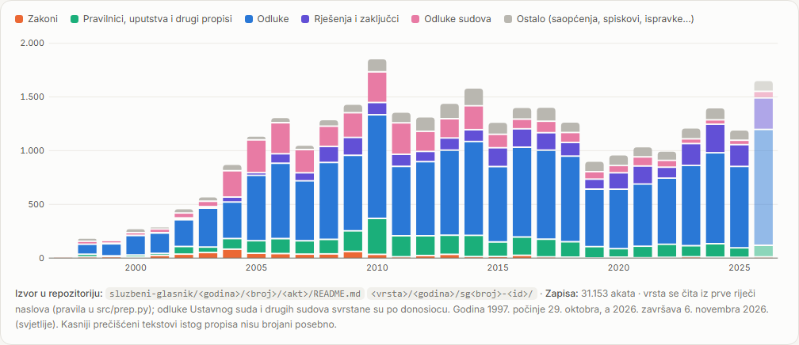

#### 2. Ko objavljuje u Glasniku

Donosioci po godini, od Vijeća ministara i Visokog sudskog i tužilačkog vijeća do Centralne banke.

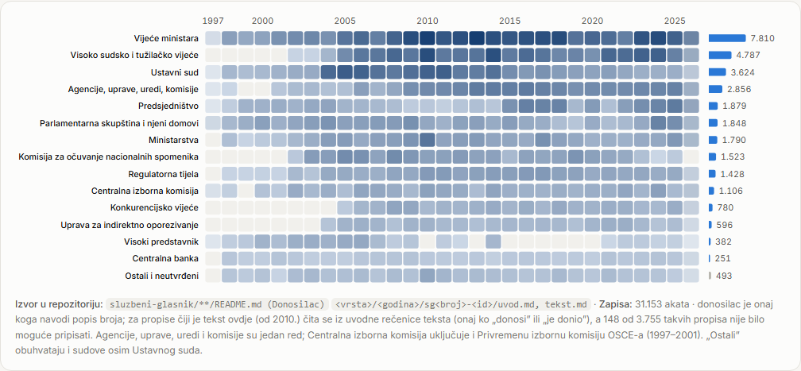

#### 3. Kada propisi stupaju na snagu

Zakoni osmog dana od objave, odluke najčešće prije nego što su objavljene.

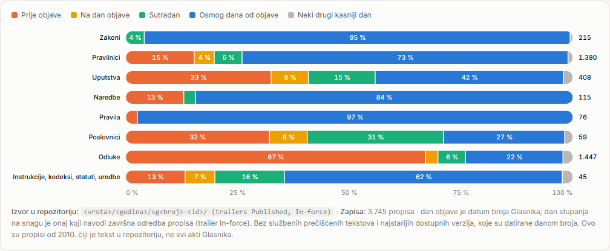

#### 4. Propisi od 2010.

Šta je bilo s 1.875 propisa čiji je tekst ovdje: izmjene bez službenog prečišćenog teksta i prestanak važenja.

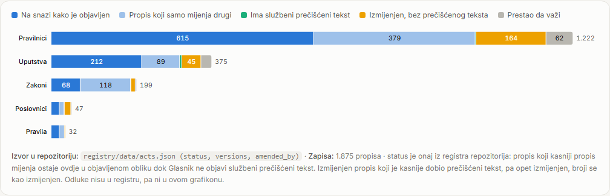

### II. Dejtonski ustav i visoki predstavnik

#### 5. Ustav (Aneks 4)

Koliko puta svaki dio Ustava imenuje entitete, konstitutivne narode, Ostale i građane.

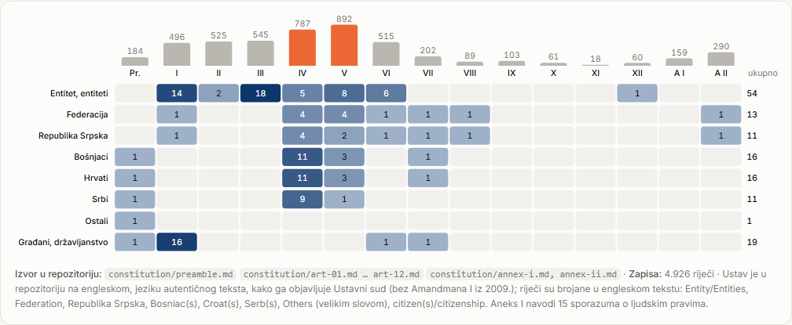

#### 6. Visoki predstavnik u Glasniku

380 akata visokog predstavnika, po mandatu i po vrsti akta.

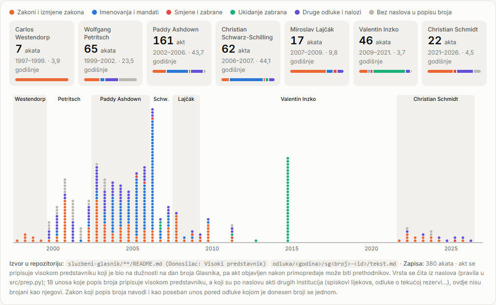

#### 7. Najčešće mijenjani zakoni

Izmjene 14 zakona po godini i po tome ko ih je donio; Izborni zakon 24 puta od 2001.

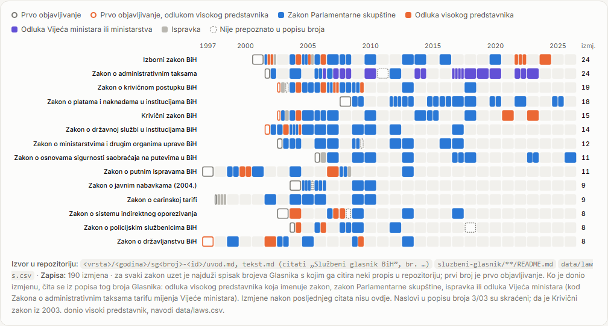

### III. Parlamentarna skupština, budžet i porezi

#### 8. Ko donosi zakone

Zakoni Parlamentarne skupštine i zakoni koje je donio visoki predstavnik, po godini.

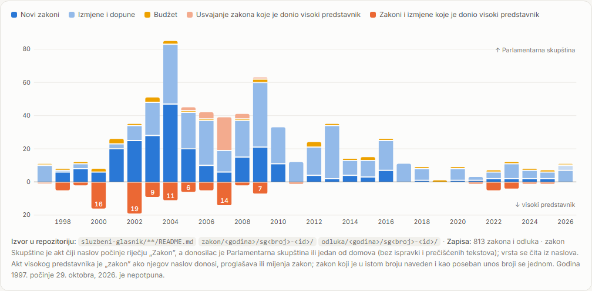

#### 9. Dva doma, isti tekst

Dani između usvajanja zakona u Predstavničkom domu i u Domu naroda.

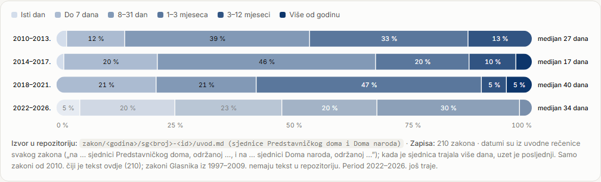

#### 10. Prijedlozi koji nisu postali zakon, 2004–2015.

233 neusvojena prijedloga po predlagaču i ishodu, i šest prijedloga amandmana na Ustav.

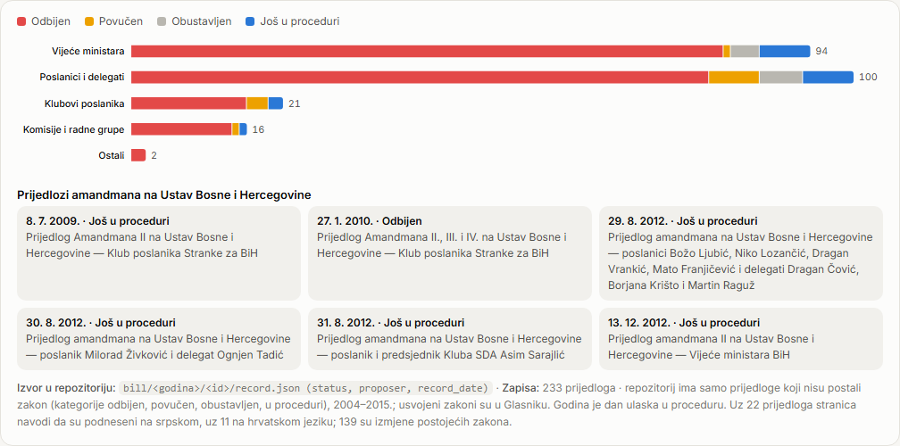

#### 11. Budžet države

Kada je Glasnik objavio zakon o budžetu za svaku godinu, prema 1. januaru te godine.

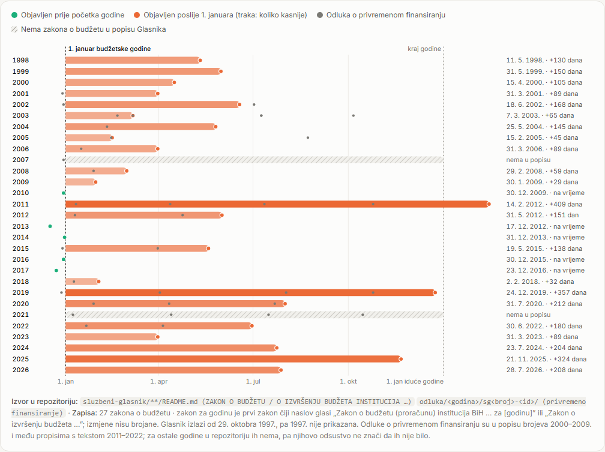

#### 12. Tekuća rezerva

Odluke o sredstvima tekuće rezerve po donosiocu: Vijeće ministara, Predsjedništvo, kolegiji domova.

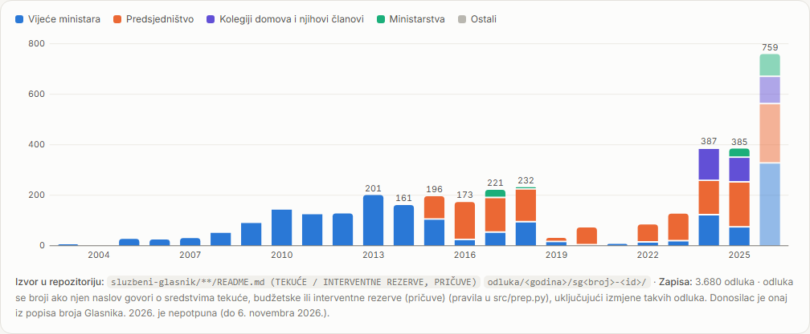

#### 13. Akciza na cigarete

Specifična i minimalna akciza i referentna cijena kutije, 2011–2027.

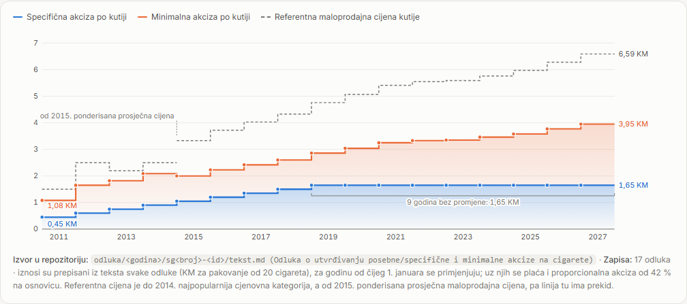

### IV. Ustavni sud

#### 14. Ustavni sud

53.975 odluka iz baze Suda po godini i po vrsti.

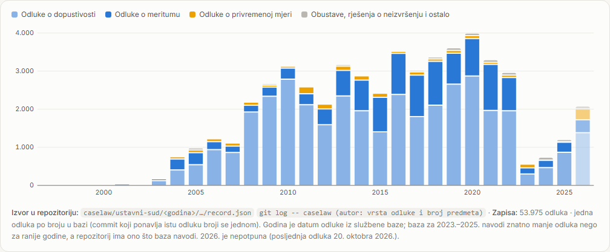

#### 15. Čekanje na odluku o meritumu

Koliko je godina apelacija čekala odluku o meritumu, po periodu.

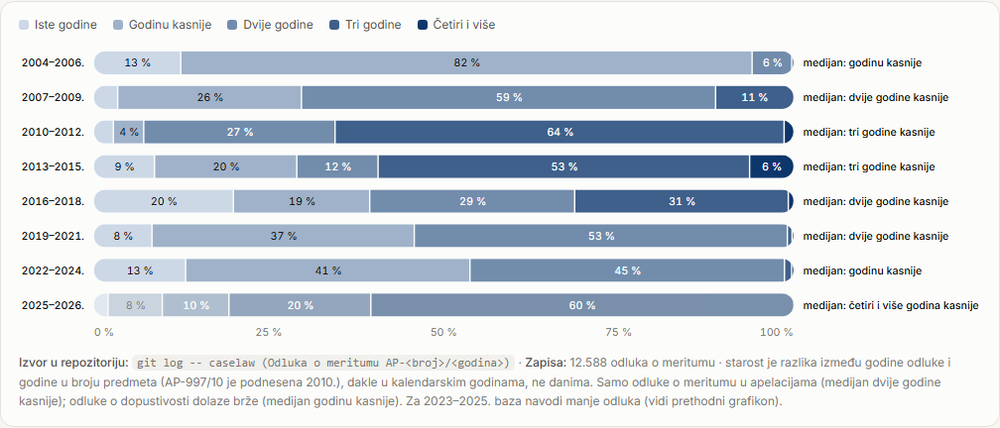

#### 16. Rješenja o neizvršenju

176 rješenja kojima je Sud utvrdio da njegova odluka nije izvršena.

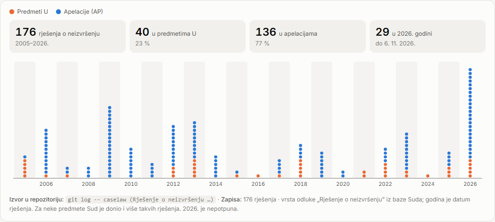

### V. Sud Bosne i Hercegovine i Visoko sudsko i tužilačko vijeće

#### 17. Sud BiH

Predmeti po godini potvrđivanja optužnice i po odjelu Suda.

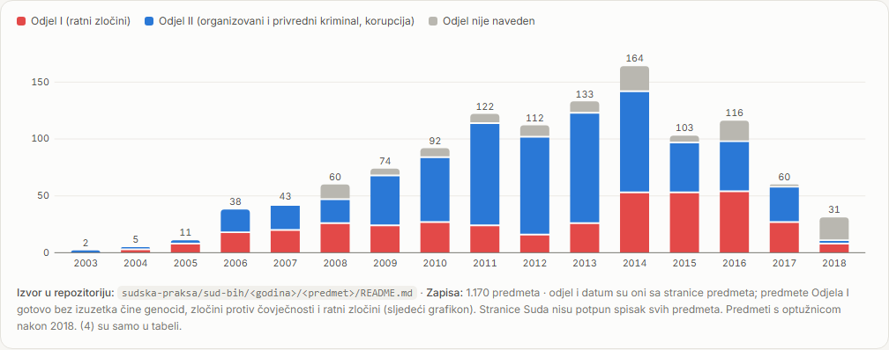

#### 18. Za šta se optužuje

Prvo krivično djelo iz optužnice, po odjelu.

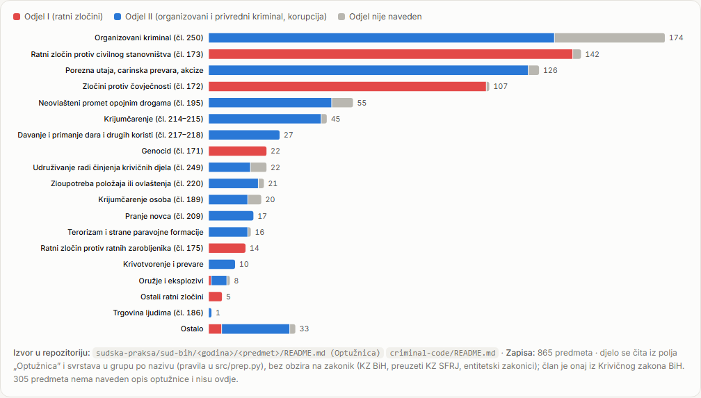

#### 19. Od potvrđene optužnice do pravosnažne presude

Medijan trajanja po godini optužnice: ratni zločini prema Odjelu II.

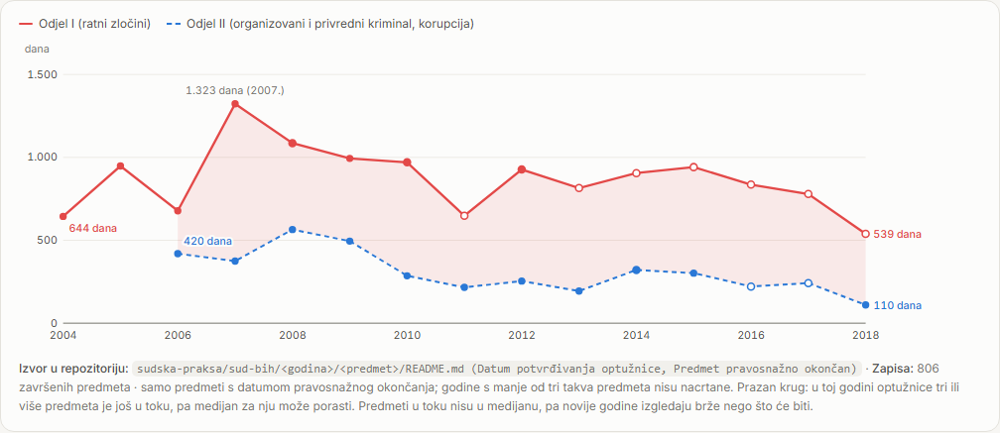

#### 20. Jedno vijeće imenuje sudije i tužioce cijele zemlje

Imenovanja Visokog sudskog i tužilačkog vijeća u Federaciji BiH, Republici Srpskoj, na državnom nivou i u Brčko distriktu.

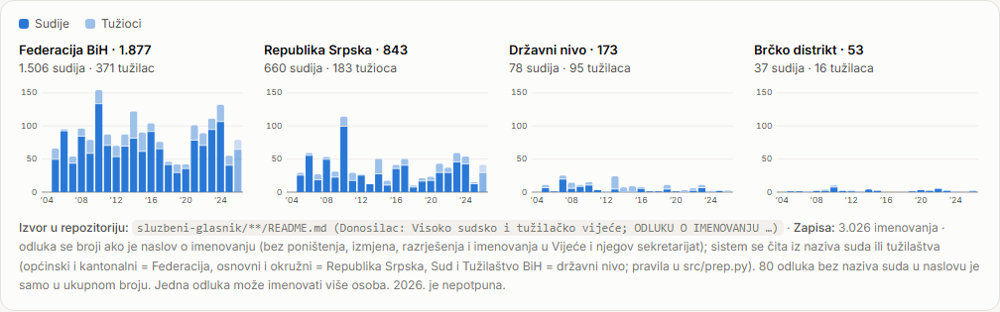

## Podaci

| Skup podataka | Gdje u repozitoriju | Zapisa | Obuhvat |
| --- | --- | ---: | --- |
| Popis akata Službenog glasnika BiH | `sluzbeni-glasnik/<godina>/<broj>/<akt>/README.md` | 27.398 | 29. 10. 1997. – 6. 11. 2026.; naslov, donosilac, broj i datum; od 2010. bez propisa čiji je tekst ovdje |
| Propisi s tekstom | `<vrsta>/<godina>/sg<broj>-<id>/` | 3.755 | 2010–2026.; zakoni, pravilnici, uputstva, odluke, naredbe i drugi, s datumima iz trailera commita |
| Registar propisa | `registry/data/acts.json` | 1.875 | status, verzije i propisi koji mijenjaju, za pet vrsta propisa |
| Ustav | `constitution/` | preambula, 12 članova, 2 aneksa | engleski tekst iz 1995., bez Amandmana I |
| Odluke Ustavnog suda | `caselaw/ustavni-sud/` (git historija) | 53.975 | 1997–2026.; vrsta odluke, broj predmeta, datum |
| Prijedlozi zakona | `bill/` | 233 | 2004–2015.; samo prijedlozi koji nisu postali zakon |
| Predmeti Suda BiH | `sudska-praksa/sud-bih/` | 1.170 | optužnice 2003–2022.; odjel, krivično djelo, datumi |
| Krivični zakon BiH | `criminal-code/README.md` | 325 članova | nazivi članova za grafikon 18 |

## Ograničenja

- **Popis Glasnika od 2010. ne navodi propise čiji je tekst u repozitoriju**, pa su ti propisi dodani iz foldera propisa (grafikoni 1, 2, 8, 12). Neki naslovi u popisu su skraćeni, a popis kod 18 unosa navodi visokog predstavnika kao donosioca akata drugih institucija; oni se ne broje kao njegovi.
- **Tekst propisa postoji samo od 2010.** Grafikoni 3, 4 i 9 i donosioci propisa s tekstom (grafikon 2) zato pokrivaju samo 2010–2026.; donosilac 148 propisa nije se mogao pročitati iz uvodne rečenice.
- **Kategorije se čitaju iz naslova i teksta** po pravilima u `src/prep.py`: vrsta akta, vrsta akta visokog predstavnika, odluke o tekućoj rezervi, krivično djelo, sistem suda. Ono što nijedno pravilo ne prepoznaje prikazano je kao „ostalo”.
- **Izmjene zakona (grafikon 7) su one koje navode kasniji propisi** kada citiraju zakon sa spiskom brojeva Glasnika; izmjene nakon posljednjeg citata nisu tu.
- **Baza Ustavnog suda za 2023–2025. navodi znatno manje odluka** nego za ranije godine; repozitorij ima ono što baza navodi.
- **Stranice Suda BiH nisu potpun spisak predmeta**, a trajanje (grafikon 19) računa se samo za pravosnažno završene predmete.
- **Nepotpuni periodi** (1997. od 29. oktobra, 2026. do 6. novembra) nacrtani su svjetlije i tako označeni.

## Kako ponovo napraviti grafikone

```sh
python visualisations/src/make.py            # git -> src/.build/ -> pravo-bosne-i-hercegovine-u-20-grafikona.html
node visualisations/src/stills.cjs           # slike za ove README datoteke (treba Playwright; PLAYWRIGHT=<putanja> ako nije globalan)
```

`make.py` čita sve iz git objekata, pa radi i u blobless klonu ili klonu bez checkouta (blobove koji nedostaju dohvata u serijama). Podrazumijevano čita `origin/main` (ili `HEAD`); `--ref` bira drugu granu ili commit. U repozitorij ne upisuje ništa osim stranice i foldera `src/.build/` (koji git ignoriše).

| Datoteka | Šta radi |
| --- | --- |
| `src/make.py` | izvlači historiju, popis Glasnika, tekstove i tabele u `src/.build/`, pa pokreće `prep.py` i `build.py` |
| `src/prep.py` | računa sve brojeve za 20 grafikona i profil podataka u `src/.build/data.json` |
| `src/page.tpl.html` | stranica: tekstovi na oba jezika, grafikoni (d3), tabele |
| `src/build.py` | upisuje `data.json` u šablon i zapisuje stranicu |
| `src/stills.cjs` | crta svaki grafikon kao PNG u `stills/bs/` i `stills/en/` |

## Licenca

Vidi [`LICENSE`](../LICENSE). Stranica, grafikoni, tabele i skripte u ovom folderu su djelo Lexifine pod licencom CC BY 4.0.

Ovo je prijevod engleske verzije ([README.en.md](README.en.md)); ako se razlikuju, važi engleska verzija.
