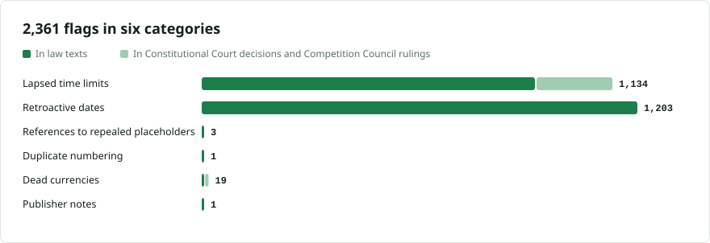

# Vulnerabilities in the law of Bosnia and Herzegovina

[Bosanski](README.md) · **English**

<picture>
<source media="(prefers-color-scheme: dark)" srcset="img/flags-by-category-dark.svg">

</picture>

The vulnerability detectors from [lexifina/global-law](https://github.com/lexifina/global-law/tree/main/vulnerabilities) look for mechanical mistakes in legislation: a rule applying "until" a date that has passed, an act in force before it was published, two amendments to the same provision on the same day, a reference to an article that no longer exists. global-law's published list (9 November 2026) did not cover Bosnia and Herzegovina, so this is a run over this repository only, the state-level law of Bosnia and Herzegovina, as it stood at commit [`992e2cf`](https://github.com/lexifina/bosnia-and-herzegovina-law/commit/992e2cfa3fdd4f0fdaeb9747fb6c919c7ceba205), read on 15 November 2026.

**In short:** the detectors raised 2,770 flags. A language model reviewed 154 of the strongest, arguing each one for and against; 11 survived. Checked by hand in this repository, none is a confirmed drafting mistake, and one is open: the Indirect Taxation Authority's decision on the compensatory interest rate for the second half of 2026 ("Službeni glasnik BiH" 79/26) was made on 26 October 2026 but says it enters into force on 1 July 2026, as did the decisions for the second half of 2024 and 2025. Of the other ten, four enter into force on the day they were made, as their own final article says, and were published months later; three are stocktaking deadlines in the cigarette excise decisions for 2019 and 2020, which passed as intended and which the next year's decision ended, though this repository still holds both as enacted; and three are spent: an election timetable, the stocktaking deadline of the excise decision for 2014, and a three-year postponement of data exclusivity for medicines that ran until July 2021. Later, this will be formalised in Lean, similar to our work on [the US tax code](https://lexifina.com/blog/formalizing-the-us-tax-code) and [US case law](https://lexifina.com/blog/formalizing-all-us-case-law-in-lean).

A flag is a prompt to look, not legal advice, and nothing here has been tested in court.

## Flags by category

| Category | What it looks for | Flags | In law texts | Reviewed | Survived review |
| --- | --- | ---: | ---: | ---: | ---: |
| Lapsed time limits | Text still applying a rule "until" a date that has passed | 1,547 | 1,209 | 114 | 6 |
| Retroactive or pre-publication dates | An act dated in force before it was published | 1,203 | 1,203 | 40 | 5 |
| References to repealed placeholders | A provision citing an article whose text is only "deleted" | 3 | 3 | 0 | 0 |
| Duplicate numbering | Two units with the same number in one file | 1 | 1 | 0 | 0 |
| Dead currencies | Amounts in currencies no longer in use | 15 | 1 | 0 | 0 |
| Publisher notes | Notes that an amendment could not be carried out | 1 | 1 | 0 | 0 |

"In law texts" counts the Constitution, the Criminal Code, the acts of Službeni glasnik BiH (laws, rulebooks, instructions, decisions, orders, rules of procedure, codes and statutes), the Central Bank's decisions in `odluke-tela/cbbih/` and four acts of the Indirect Taxation Authority in `misljenja/`. The other flags are in Constitutional Court decisions and Competition Council rulings, which this repository also holds, together with bills and Court of BiH decisions, and which are not law. The searches for repeal gaps, same-day conflicts, empty periods, stale amounts, references to deleted provisions and dead fines found nothing to flag: this repository keeps an act as enacted and gives later versions only from official consolidated texts (235 acts are amended but not consolidated, by its README), so few provisions change in its history.

*Edge cases: the 11 flags that survived the review, grouped by what they turned out to be, and what the other flags are, in [EDGE-CASES.en.md](EDGE-CASES.en.md).*

## Problems found in this repository

- **The root README is out of date.** It counts 1,875 acts (199 laws and 1,676 rulebooks, instructions, rules of procedure and rules) and lists case law as "planned elsewhere", but the commit read also holds 1,443 decisions (`odluka/`), 109 orders (`naredba/`), instructions, codes, statutes and a decree, 53,975 Constitutional Court decisions (`caselaw/`), 105 decisions of the Constitutional Court and the Court of BiH (`sudska-praksa/`), 233 bills (`bill/`), 388 Competition Council rulings and 7 Central Bank decisions (`odluke-tela/`).
- **Dates:** the README says a Gazette act takes effect "almost always the eighth day after its publication". Of the 3,517 acts whose commits carry a publication date, 1,846 do, and 1,210 are dated before publication, mostly because their final article puts them in force on the day they were made. The dates follow the acts' final articles; every flag checked does (in [Edge cases](EDGE-CASES.en.md)), but in one, the timetable of the 2016 local elections ("Službeni glasnik BiH" 32/16), the record dates the act 4 April 2016 although its preamble says it was adopted on 4 May 2016.
- **Annual decisions ended by the next one are held as enacted.** Each year's decision of the Indirect Taxation Authority on cigarette excise ends the previous year's from the day it applies ("prestaje da važi ...", naming it by its Gazette number). Of the 17 such decisions at the commit read (made from 2010 to 2026), 15 are ended in this way, yet all 15 are held as enacted with no repeal, and `registry/data/acts.json`, which marks repealed acts, lists no decisions (`odluka/`) at all. 133 of the lapsed-time-limit flags are in these 17 files.
- **`misljenja/` (opinions)** holds four acts of the Indirect Taxation Authority, two rulebooks and two instructions, each marked `"is_law": true`, not opinions.
- **Lost characters:** 527 replacement characters (�) in 144 law-text files stand where the source had °, ‰, β, superscripts or accented letters: "članarinu od 1� (jedan promil)" in [odluka/2010/sg086-d06e59](https://github.com/lexifina/bosnia-and-herzegovina-law/blob/992e2cfa3fdd4f0fdaeb9747fb6c919c7ceba205/odluka/2010/sg086-d06e59/tekst.md), "17 �-estradiol" in [odluka/2010/sg074-897ced](https://github.com/lexifina/bosnia-and-herzegovina-law/blob/992e2cfa3fdd4f0fdaeb9747fb6c919c7ceba205/odluka/2010/sg074-897ced/tekst.md).
- **`LICENSE`** describes only the Constitution's English text, not the Gazette acts, the Criminal Code or the decisions the repository now holds.

## Files

| File | What it holds |
| --- | --- |
| [data/flags.csv](data/flags.csv) | Every flag, one row per provision or act and issue |
| [data/reviewed.csv](data/reviewed.csv) | The 154 flags the model reviewed, with its verdict and reason |
| [data/by_category.csv](data/by_category.csv) | The counts in the table above |
| [tools/](tools/) | The scripts that made this run |

Columns: `category` and `category_bs` (the category in English and Bosnian), `detector`, `kind` (`law` or `other`), `path` (the file in this repository), `date` (the date the flag turns on), `reference` (the act or line involved), `summary`, `score` (the detector's ranking, 0 to 1), `review` (`artefact`, `lawful` or `candidate_defect`), `survives_rebuttal`, `review_note` (the model's reason, in English), `url` (the file at the commit that was read, or, for an act dated before publication, the act's commit).

## How it was made

- **Detectors:** global-law's [vulnerabilities/scripts](https://github.com/lexifina/global-law/tree/main/vulnerabilities/scripts), run on this repository at commit `992e2cf`. global-law replays this repository only up to an earlier commit, so the history table the detectors read was built from this repository's own commits (the author, the act that made each change, and the `In-force`, `Published` and `Kind` trailers). Gazette acts, the Constitution and the consolidated texts count as law; Constitutional Court decisions, bills and Competition Council rulings do not. The detectors were then run again with fixes that read in time limits the Bosnian month names it did not know ("januara", "februara", "marta", "juna", "jula"), numeric dates written with spaces, "do dana" and "zaključno sa" before a date and "do kraja" before a year, that rank "najkasnije" as a deadline, and that take "DM" only in capitals; a second run, for fixes made for other countries, changed no flag here; a third, after the scans were made to split their work the same way in every process, ties among the strongest flags were broken the same way every time and "lira" was matched only at the start of a word, removed one false currency match ("kontrolira 1%").
- **Model review:** gpt-5.4-mini, the 40 strongest flags per category, and for lapsed time limits also the 40 strongest in law texts (here the same); one pass says whether a flag is real, a second argues that it is not. After the first fixes the 40 strongest lapsed time limits were reviewed again, after the second run the 40 strongest not yet reviewed, and after the third 34 more, keeping the earlier reviews: 114 in all. Where a flag was reviewed twice, the later review is kept. global-law's own list used a different model.
- **Hand check:** every case that survived was read in this repository's history and texts, and the dates of all 1,203 acts dated before publication were compared with their final articles, as each commit's `In-force-basis` quotes them or as the text reads. In law texts, every "do <date>" phrase (1,126), "zaključno sa <date>" (113), "do dana <date>" (2) and "do kraja <year>. godine" (28) is now read by the search for lapsed time limits; before the fixes, 178 of the 1,126 were not (`tools/do_gap_check.py`). The open case still needs Article 372 of the Decision on the implementation of the Law on Customs Policy ("Službeni glasnik BiH" 13/19), which this repository does not hold.

To report a correction, open an issue with the provision and an official source.

## Licence

The lists and notes are Lexifina's, under CC BY 4.0 like the rest of this repository's own contributions. Quoted law text is as Službeni list BiH and the courts publish it; see [LICENSE](../LICENSE) and the [README](../README.en.md#licence).
