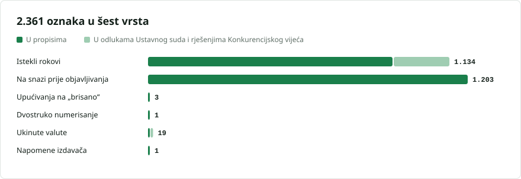

# Ranjivosti u propisima Bosne i Hercegovine

**Bosanski** · [English](README.en.md)

<picture>
<source media="(prefers-color-scheme: dark)" srcset="img/flags-by-category-dark.bs.svg">

</picture>

Detektori ranjivosti iz repozitorija [lexifina/global-law](https://github.com/lexifina/global-law/tree/main/vulnerabilities) traže mehaničke greške u propisima: pravilo koje se i dalje primjenjuje „do“ datuma koji je prošao, propis koji stupa na snagu prije nego što je objavljen, dvije izmjene iste odredbe istog dana, upućivanje na član koji više ne postoji. Lista koju je global-law objavio 9. novembra 2026. nije obuhvatala Bosnu i Hercegovinu, pa je ovo provjera samo ovog repozitorija, propisa države Bosne i Hercegovine, u stanju na commitu [`992e2cf`](https://github.com/lexifina/bosnia-and-herzegovina-law/commit/992e2cfa3fdd4f0fdaeb9747fb6c919c7ceba205), pročitanom 15. novembra 2026.

**Ukratko:** detektori su označili 2.770 mjesta. Jezički model je pregledao 154 najjača i za svako iznio argumente za i protiv; 11 ih je izdržalo provjeru. Pregledano ručno u ovom repozitoriju, nijedno nije potvrđena greška u propisima, a jedno je otvoreno: Odluka o visini stope kompenzatorne kamate za drugu polovinu 2026. godine Uprave za indirektno oporezivanje („Službeni glasnik BiH“, broj 79/26) donesena je 26. oktobra 2026. godine, a prema njoj stupa na snagu 1. jula 2026. godine, kao i odluke za drugu polovinu 2024. i 2025. godine. Od preostalih deset, četiri propisa stupaju na snagu danom donošenja, kako kaže njihov završni član, a objavljena su mjesecima kasnije; tri su roka za popis zaliha iz odluka o akcizi na cigarete za 2019. i 2020. godinu, koji su protekli kako je predviđeno, a same odluke prestale su da važe narednom godišnjom odlukom, iako ih ovaj repozitorij i dalje vodi onako kako su donesene; tri su istekla: izborni rokovnik, rok za popis zaliha iz odluke o akcizi za 2014. godinu i trogodišnje odgađanje ekskluzivnosti podataka za lijekove, koje je trajalo do jula 2021. godine. Kasnije će ovo biti formalizovano u Leanu, slično našem radu na [poreskom zakoniku SAD-a](https://lexifina.com/blog/formalizing-the-us-tax-code) i [sudskoj praksi SAD-a](https://lexifina.com/blog/formalizing-all-us-case-law-in-lean).

Oznaka je poziv da se pogleda, a ne pravni savjet, i ništa od ovoga nije provjereno pred sudom.

## Oznake po vrsti

| Vrsta | Šta traži | Oznake | U propisima | Pregledano | Izdržalo pregled |
| --- | --- | ---: | ---: | ---: | ---: |
| Istekli rokovi | Tekst koji se i dalje primjenjuje „do“ datuma koji je prošao | 1.547 | 1.209 | 114 | 6 |
| Stupanje na snagu prije objavljivanja | Propis koji je na snazi prije nego što je objavljen | 1.203 | 1.203 | 40 | 5 |
| Upućivanja na odredbe „brisano“ | Odredba koja upućuje na član čiji je jedini tekst „brisan“ | 3 | 3 | 0 | 0 |
| Dvostruko numerisanje | Dvije jedinice s istim brojem u jednoj datoteci | 1 | 1 | 0 | 0 |
| Ukinute valute | Iznosi u valutama koje se više ne koriste | 15 | 1 | 0 | 0 |
| Napomene izdavača | Napomene da izmjena nije mogla biti unesena | 1 | 1 | 0 | 0 |

„U propisima“ obuhvata Ustav, Krivični zakon, propise objavljene u Službenom glasniku BiH (zakone, pravilnike, uputstva, odluke, naredbe, poslovnike, kodekse i statute), odluke Centralne banke u `odluke-tela/cbbih/` i četiri akta Uprave za indirektno oporezivanje u `misljenja/`. Ostale oznake su u odlukama Ustavnog suda i rješenjima Konkurencijskog vijeća, koje ovaj repozitorij također sadrži, zajedno s prijedlozima zakona i odlukama Suda BiH, i koji nisu propisi. Traženje praznina nakon stavljanja van snage, izmjena istog dana, praznih perioda, zastarjelih iznosa, upućivanja na brisane odredbe i kazni bez opisa prekršaja nije ništa označilo: ovaj repozitorij zadržava propis onako kako je donesen, a kasnije verzije daju samo službeni prečišćeni tekstovi (prema njegovom README-u, 235 propisa je izmijenjeno, ali nije prečišćeno), pa se u njegovoj historiji malo odredaba mijenja.

*Granični slučajevi: 11 oznaka koje su izdržale pregled, grupisane prema tome šta su se pokazale, i šta su ostale oznake, u [EDGE-CASES.md](EDGE-CASES.md).*

## Problemi pronađeni u ovom repozitoriju

- **Glavni README je zastario.** Navodi 1.875 propisa (199 zakona i 1.676 pravilnika, uputstava, poslovnika i pravila), a sudsku praksu kao „planiranu drugdje“, dok pročitani commit sadrži i 1.443 odluke (`odluka/`), 109 naredbi (`naredba/`), instrukcije, kodekse, statute i jednu uredbu, 53.975 odluka Ustavnog suda (`caselaw/`), 105 odluka Ustavnog suda i Suda BiH (`sudska-praksa/`), 233 prijedloga zakona (`bill/`), 388 rješenja Konkurencijskog vijeća i 7 odluka Centralne banke (`odluke-tela/`).
- **Datumi:** README kaže da propis iz Glasnika stupa na snagu „gotovo uvijek osmi dan od objavljivanja“. Od 3.517 propisa čiji commitovi nose datum objavljivanja, tako je kod njih 1.846, a 1.210 ih je datirano prije objavljivanja, uglavnom zato što ih završni član stavlja na snagu danom donošenja. Datumi slijede završne članove samih propisa; tako je kod svake provjerene oznake (u [graničnim slučajevima](EDGE-CASES.md)), ali kod jedne, rokovnika za lokalne izbore 2016. godine („Službeni glasnik BiH“, broj 32/16), zapis kao dan donošenja navodi 4. april 2016. godine, iako je prema uvodu propis donesen 4. maja 2016. godine.
- **Godišnje odluke koje je zamijenila naredna vode se onako kako su donesene.** Svaka godišnja odluka Uprave za indirektno oporezivanje o akcizi na cigarete stavlja van snage odluku za prethodnu godinu od dana početka svoje primjene („prestaje da važi ...“, navodeći je s brojem Glasnika). Od 17 takvih odluka u pročitanom commitu (donesenih od 2010. do 2026. godine), na taj način je prestalo da važi njih 15, ali se svih 15 vodi onako kako su donesene, bez prestanka važenja, a `registry/data/acts.json`, u kojem su označeni propisi stavljeni van snage, ne navodi nijednu odluku (`odluka/`). U tih 17 datoteka nalaze se 133 oznake isteklih rokova.
- **`misljenja/` (mišljenja)** sadrži četiri akta Uprave za indirektno oporezivanje, dva pravilnika i dvije instrukcije, svaki označen kao `"is_law": true`, a ne mišljenja.
- **Izgubljeni znakovi:** 527 zamjenskih znakova (�) u 144 datoteke s propisima stoji na mjestu gdje je izvor imao °, ‰, β, eksponente ili slova s dijakritikom: „članarinu od 1� (jedan promil)“ u [odluka/2010/sg086-d06e59](https://github.com/lexifina/bosnia-and-herzegovina-law/blob/992e2cfa3fdd4f0fdaeb9747fb6c919c7ceba205/odluka/2010/sg086-d06e59/tekst.md), „17 �-estradiol“ u [odluka/2010/sg074-897ced](https://github.com/lexifina/bosnia-and-herzegovina-law/blob/992e2cfa3fdd4f0fdaeb9747fb6c919c7ceba205/odluka/2010/sg074-897ced/tekst.md).
- **`LICENSE`** opisuje samo engleski tekst Ustava, a ne propise iz Glasnika, Krivični zakon ni odluke koje repozitorij sada sadrži.

## Datoteke

| Datoteka | Šta sadrži |
| --- | --- |
| [data/flags.csv](data/flags.csv) | Sve oznake, jedan red po odredbi ili propisu i problemu |
| [data/reviewed.csv](data/reviewed.csv) | 154 oznake koje je model pregledao, s ocjenom i obrazloženjem |
| [data/by_category.csv](data/by_category.csv) | Brojevi iz tabele iznad |
| [tools/](tools/) | Skripte kojima je provjera urađena |

Kolone: `category` i `category_bs` (vrsta na engleskom i bosanskom), `detector`, `kind` (`law` za propis ili `other`), `path` (datoteka u ovom repozitoriju), `date` (datum na koji se oznaka odnosi), `reference` (propis ili red o kojem je riječ), `summary`, `score` (rangiranje detektora, od 0 do 1), `review` (`artefact` za grešku u podacima, `lawful` za zakonito ili `candidate_defect` za moguću grešku), `survives_rebuttal`, `review_note` (obrazloženje modela, na engleskom), `url` (datoteka u pročitanom commitu, a za propis datiran prije objavljivanja commit tog propisa).

## Kako je urađeno

- **Detektori:** [vulnerabilities/scripts](https://github.com/lexifina/global-law/tree/main/vulnerabilities/scripts) iz repozitorija global-law, pokrenuti nad ovim repozitorijem na commitu `992e2cf`. global-law ponavlja ovaj repozitorij samo do ranijeg commita, pa je tabela historije koju detektori čitaju napravljena iz vlastitih commitova ovog repozitorija (autor, tj. propis koji je izmjenu donio, i traileri `In-force`, `Published` i `Kind`). Propisi iz Glasnika, Ustav i prečišćeni tekstovi računaju se kao propisi; odluke Ustavnog suda, prijedlozi zakona i rješenja Konkurencijskog vijeća ne računaju se. Detektori su zatim ponovo pokrenuti s ispravkama: u rokovima sada čitaju nazive mjeseci koje ranije nisu poznavali („januara“, „februara“, „marta“, „juna“, „jula“), brojčane datume s razmacima, „do dana“ i „zaključno sa“ ispred datuma i „do kraja“ ispred godine, „najkasnije“ rangiraju kao krajnji rok, a „DM“ uzimaju samo velikim slovima; drugo pokretanje, s ispravkama za druge zemlje, ovdje nije promijenilo nijednu oznaku; treće, nakon što skeniranje dijeli posao na isti način u svakom procesu, izjednačene najjače oznake se uvijek razvrstavaju istim redom, a „lira“ se traži samo na početku riječi, uklonilo je jedan lažni pogodak valute („kontrolira 1%“).
- **Pregled modelom:** gpt-5.4-mini, 40 najjačih oznaka po vrsti, a za istekle rokove i 40 najjačih u propisima (ovdje istih); jedan prolaz ocjenjuje da li je oznaka stvarna, drugi iznosi argumente da nije. Nakon prvih ispravki ponovo je pregledano 40 najjačih isteklih rokova, nakon drugog pokretanja 40 najjačih koji još nisu bili pregledani, a nakon trećeg još 34, uz zadržavanje ranijih pregleda: ukupno 114. Gdje je oznaka pregledana dvaput, zadržan je kasniji pregled. Lista samog global-law napravljena je drugim modelom.
- **Ručna provjera:** svaki slučaj koji je izdržao pregled pročitan je u historiji i tekstovima ovog repozitorija, a datumi svih 1.203 propisa datirana prije objavljivanja upoređeni su s njihovim završnim članovima, kako ih navodi trailer `In-force-basis` svakog commita ili kako glase u tekstu. Traženje isteklih rokova sada u propisima čita svaki izraz „do <datum>“ (1.126), „zaključno sa <datum>“ (113), „do dana <datum>“ (2) i „do kraja <godina>. godine“ (28); prije ispravki nije pročitano 178 od tih 1.126 (`tools/do_gap_check.py`). Za otvoreni slučaj potreban je član 372. Odluke o provođenju Zakona o carinskoj politici u Bosni i Hercegovini („Službeni glasnik BiH“, broj 13/19), koje u ovom repozitoriju nema.

Ispravku možete prijaviti otvaranjem issuea s odredbom i zvaničnim izvorom.

## Licenca

Liste i napomene su doprinos Lexifine, pod licencom CC BY 4.0, kao i ostali vlastiti doprinosi ovog repozitorija. Citirani tekst propisa je onakav kakav ga objavljuju Službeni list BiH i sudovi; vidi [LICENSE](../LICENSE) i [README](../README.md#licenca).
